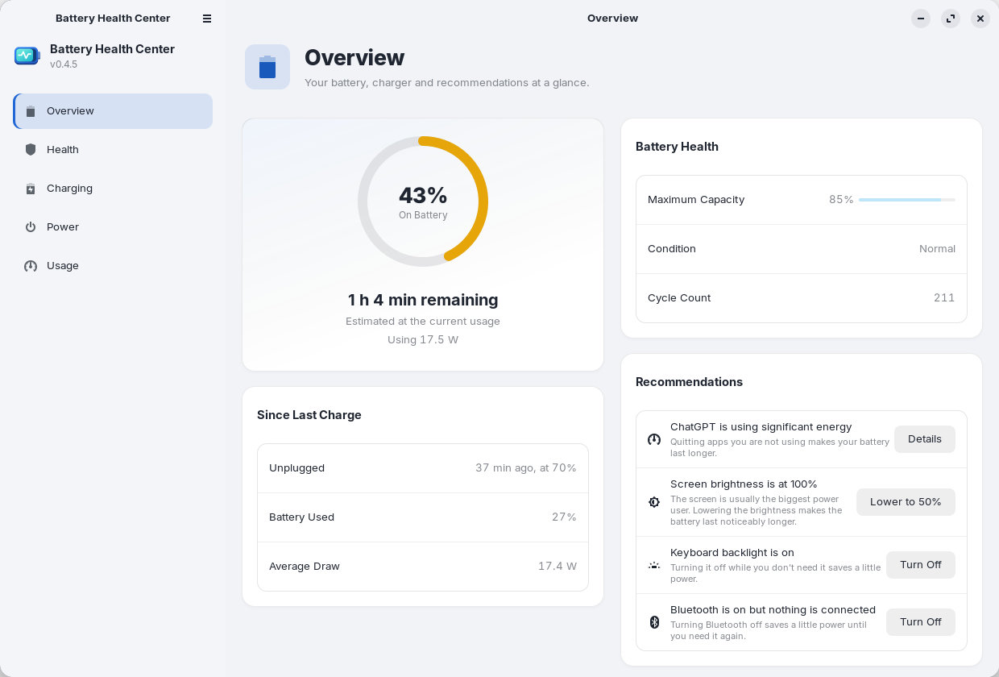
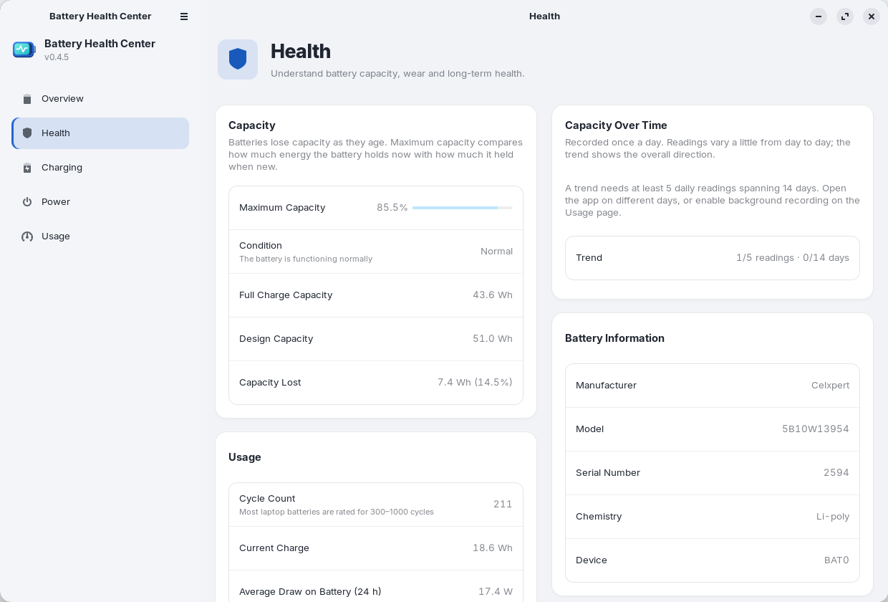
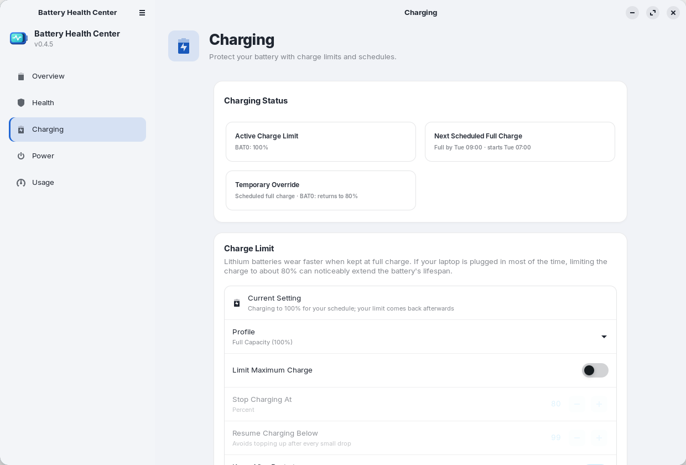
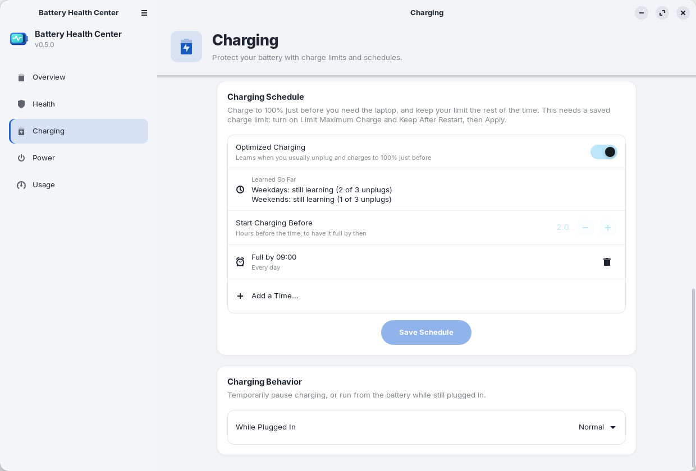
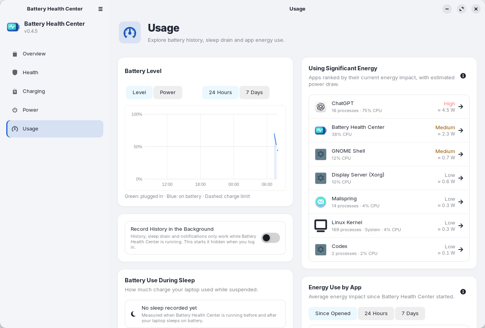
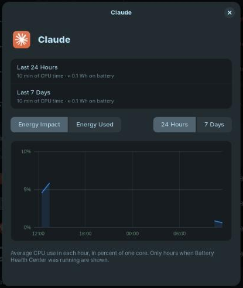
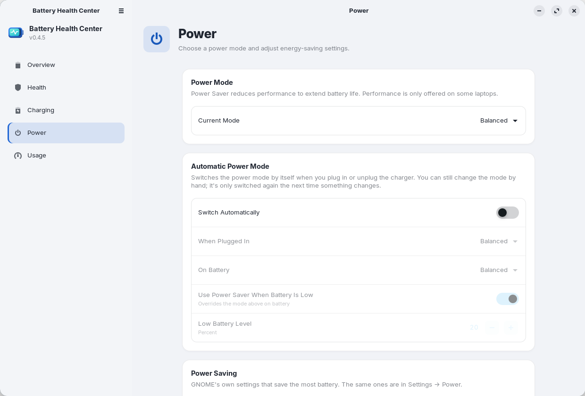

<div align="center">

[English](README.md) · [Español](README.es.md) · **Deutsch** · [Français](README.fr.md)


# Battery Health Center

**Alles über den Akku Ihres Laptops an einem Ort.**
Zustand, Ladezyklen, Ladelimits und Ladepläne und welche Apps ihn leeren, für GNOME.

[](https://github.com/arios4k/battery-health-center/releases/latest)
[](https://github.com/arios4k/battery-health-center/actions/workflows/ci.yml)
[](#installation-ubuntu-debian-und-abkömmlinge)
[](#installation-fedora)
[](LICENSE)
[](#übersetzungen)
[](#aus-dem-quellcode-bauen)

<picture>
  <source media="(prefers-color-scheme: dark)" srcset="docs/screenshots/overview-dark.png">
  
</picture>

</div>

## Eine App statt eines Haufens Skripte

Linux liefert die Akkuwerte, aber verstreut: ein Terminal voller `upower`- und `/sys`-Dateien, eine
Shell-Erweiterung für das Ladelimit, `powertop` für Vermutungen über Apps. Battery Health Center fasst sie in
einer nativen GNOME-App zusammen, ähnlich den Akku-Einstellungen von macOS:

| Statt … | bietet Battery Health Center |
|---|---|
| `/sys/class/power_supply` und `upower -i` von Hand zu lesen | **Zustand**: maximale Kapazität im Vergleich zur Nennkapazität, Ladezyklen, Zustand und ein Trend mit dem voraussichtlichen Datum für 80 % |
| einem Skript oder einer Erweiterung für das Ladelimit | **Laden**: Profile per Fingertipp, ein eigenes Limit, ein Ladeplan und optimiertes Laden |
| Raten, welche App den Akku leert | **Nutzung**: Apps nach Energie sortiert, mit geschätzten Watt und einer Stundenansicht für jede |
| dem Durchsuchen von Einstellungen, Optimierungen und Erweiterungen nach Energieoptionen | **Energie**: Energiemodus, automatischer Energiemodus und die Energiespareinstellungen von GNOME auf einer Seite |
| einer Tabelle mit Messwerten | **Berichte**: ein HTML-Akkubericht und CSV-Exporte Ihres Verlaufs |

## Funktionen

### 🔋 Wissen, wie gesund Ihr Akku wirklich ist

Die maximale Kapazität im Vergleich zum Neuzustand, sein Zustand (Normal, Abgenutzt oder Service empfohlen),
Ladezyklen, Spannung, Hersteller, Modell und Zellchemie. Die Kapazität wird einmal am Tag aufgezeichnet, sodass
Sie nach etwa zwei Wochen einen Trend und das Datum erhalten, an dem voraussichtlich 80 % erreicht werden.
Springt die Prozentanzeige oder schaltet sich der Laptop zu früh ab, behebt eine geführte Kalibrierung (laden,
fast leer laufen lassen, wieder laden) die Anzeige. Laptops mit zwei Akkus werden unterstützt.

<picture>
  <source media="(prefers-color-scheme: dark)" srcset="docs/screenshots/health-dark.png">
  
</picture>

### 🛡️ Den Akku jahrelang schonen

Lithium-Akkus verschleißen schneller, wenn sie auf 100 % stehen. Wählen Sie ein Profil, **Maximale
Lebensdauer (60 %)**, **Ausgeglichen (80 %)** oder **Volle Kapazität (100 %)**, oder legen Sie genau fest, wo
das Laden stoppt und wieder beginnt. Das Limit bleibt nach Neustarts und Ruhezustand erhalten. Für eine Reise
einen vollen Akku nötig? **Jetzt auf 100 % laden** lädt einmal vollständig, danach kehrt Ihr Limit von selbst
zurück.

<picture>
  <source media="(prefers-color-scheme: dark)" srcset="docs/screenshots/charging-dark.png">
  
</picture>

### 🗓️ Voll, wenn Sie es brauchen, geschützt in der übrigen Zeit

Sagen Sie, wann Sie den Laptop brauchen, zum Beispiel **werktags um 07:30**: Das Limit wird kurz davor
aufgehoben, damit der Akku rechtzeitig voll ist, und danach wieder gesetzt. Oder schalten Sie das **optimierte
Laden** ein, das Ihre Gewohnheiten daran lernt, wann Sie normalerweise den Stecker ziehen. Ihr Passwort geben
Sie nur einmal ein, beim Speichern des Plans; ein kleiner Dienst erledigt den Rest.

<picture>
  <source media="(prefers-color-scheme: dark)" srcset="docs/screenshots/schedule-dark.png">
  
</picture>

### 📊 Sehen, was ihn leert

Akkustand und Leistungsaufnahme des letzten Tages oder der letzten Woche, der Akkuverbrauch im Ruhezustand des
Laptops (mit einer Warnung, wenn er ungewöhnlich hoch ist) und die Apps, die gerade, seit dem Öffnen der App oder
in 24 Stunden und 7 Tagen am meisten Energie verbrauchen. Klicken Sie auf eine App, um ihre Energieauswirkung
und die geschätzte Nutzung Stunde für Stunde zu sehen. Linux misst die Leistung nicht pro App; die Zahlen sind
Schätzungen aus der CPU-Zeit und der gemessenen Leistungsaufnahme über dem Leerlauf.

<picture>
  <source media="(prefers-color-scheme: dark)" srcset="docs/screenshots/usage-dark.png">
  
</picture>

<div align="center">

</div>

### ⚡ Energiemodi ohne Suchen

Energiesparmodus, Ausgeglichen oder Leistung, mit einem **automatischen Energiemodus**, der beim Anstecken oder
Abziehen des Ladegeräts wechselt, dazu die Energiespareinstellungen von GNOME (Bildschirm abdunkeln,
Bildschirm ausschalten, automatische Bereitschaft, Ein-/Aus-Taste und Deckel) und die Akkuanzeige in Prozent in
der oberen Leiste. Angezeigt wird nur, was Ihre Hardware unterstützt.

<picture>
  <source media="(prefers-color-scheme: dark)" srcset="docs/screenshots/power-dark.png">
  
</picture>

### 💡 Kleine Hinweise, kein Dauergemecker

Im Akkubetrieb kann die Übersicht vorschlagen, einen sehr hellen Bildschirm herunterzudimmen, die
Tastaturbeleuchtung auszuschalten oder Bluetooth auszuschalten, wenn nichts verbunden ist, jeweils mit einer
Schaltfläche. Benachrichtigungen melden, wenn das Ladelimit erreicht ist, wenn der Akku ohne Limit voll ist,
wenn der Akku schwach ist, wenn eine App ihn leert und wenn der Laptop im Ruhezustand viel Akku verbraucht hat.
In den Einstellungen können Sie sie abschalten (außer den Schritten der Kalibrierung).

### 📤 Ihre Daten mitnehmen

Exportieren Sie über das Menü einen HTML-Akkubericht (für einen Garantiefall oder beim Verkauf des Laptops) oder
führen Sie `battery-health-center --export-report report.html` aus. **Daten als CSV exportieren** (oder
`battery-health-center --export-csv <Ordner>`) schreibt den Akkuverlauf, die Kapazität im Zeitverlauf, die
Ruhezustandssitzungen und den Energieverbrauch jeder App pro Stunde als CSV-Dateien für eine Tabellenkalkulation.

## Warum Battery Health Center

- **Nativ und leicht.** Rust mit GTK 4 und libadwaita: ein Programm von 1,2 MB (ein Paket von 0,5 MB), heller und
  dunkler Modus, und es folgt Ihrem GNOME-Design.
- **Privat von Grund auf.** Alles bleibt auf Ihrem Computer: Die App verbindet sich nie mit dem Internet und
  hat keine Telemetrie. Der Verlauf besteht aus einigen CSV-Dateien in Ihrem Home-Ordner.
- **Sorgfältig mit Root-Rechten.** Nur ein kleiner Helfer läuft als root. Er akzeptiert nur geprüfte Werte und
  schreibt ausschließlich die Ladelimit-Dateien des Akkus und seine eigene Konfiguration.
- **Spricht Ihre Sprache.** Englisch, Spanisch, Deutsch und Französisch, passend zu Ihrer Systemsprache.
- **Aktualisiert sich mit Ihrem System.** Installieren Sie sie aus einem signierten apt-Repository (oder dem COPR
  von Fedora), und Ihre üblichen Updates halten sie aktuell.

## FAQ

**Funktioniert das Ladelimit auf meinem Laptop?**
Akkuinformationen funktionieren auf jedem Laptop mit einem Standard-Akkutreiber für Linux. Ladelimits erfordern
Firmware-Unterstützung, die der Kernel als `charge_control_end_threshold` (oder `charge_stop_threshold`)
bereitstellt, wie bei ThinkPads und vielen Laptops von ASUS, Dell, Huawei, LG, Samsung und System76. Hat Ihrer
sie nicht, weist die Seite Laden darauf hin, und alles andere funktioniert weiterhin.

**Welche Desktops und Distributionen?**
Entwickelt und getestet wird unter GNOME: Ubuntu 24.04, Zorin OS 18 und Linux Mint 22. Das Paket benötigt
GTK 4.14 und libadwaita 1.5 oder neuer, daher sind Ubuntu 22.04, Debian 12 und Mint 21 zu alt. Die Seite Energie
nutzt die eigenen Einstellungen von GNOME und ist deshalb der am stärksten an GNOME gebundene Teil.

**Ist es sicher, das Ladelimit zu ändern?**
Es setzt dieselben Firmware-Schwellenwerte, die auch andere Werkzeuge und BIOS-Optionen verwenden, und **Volle
Kapazität (100 %)** hebt das Limit wieder auf. Für die Änderung wird Ihr Passwort abgefragt.

**Muss ich die App geöffnet lassen?**
Verlauf, Ruhezustandsverbrauch und Benachrichtigungen werden aufgezeichnet, solange die App läuft. Beim ersten
Öffnen fragt sie, ob sie den **Verlauf im Hintergrund aufzeichnen** soll; sagen Sie ja, und sie startet beim
Anmelden unsichtbar. Sie können es sich jederzeit auf der Seite Nutzung anders überlegen.

<sub>Screenshots aufgenommen unter Zorin OS 18 mit dem Design ZorinBlue. Erzeugen Sie sie neu mit
`docs/screenshots/capture.sh`.</sub>

## Installation (Ubuntu, Debian und Abkömmlinge)

Für Ubuntu 24.04+, Debian 13+, Linux Mint 22, Zorin OS 18 und andere Abkömmlinge auf 64-Bit-Intel/AMD:

```bash
sudo install -d -m 0755 /etc/apt/keyrings
curl -fsSL https://arios4k.github.io/apt/key.asc | sudo tee /etc/apt/keyrings/battery-health-center.asc > /dev/null
echo "deb [signed-by=/etc/apt/keyrings/battery-health-center.asc] https://arios4k.github.io/apt stable main" | sudo tee /etc/apt/sources.list.d/battery-health-center.list
sudo apt update && sudo apt install battery-health-center
```

Öffnen Sie danach **Battery Health Center** in Ihren Anwendungen. Updates kommen mit `sudo apt upgrade`. Der
Fingerabdruck des Signaturschlüssels lautet `F090 D01D 74F7 14C8 5A95 23CA 4773 367E BD97 6CF5`, und das
Repository (mit Tipps zur Fehlersuche) finden Sie unter [arios4k/apt](https://github.com/arios4k/apt).

## Installation (Fedora)

Für Fedora 43 und neuer auf 64-Bit-Intel/AMD, aus dem [COPR-Repository](https://copr.fedorainfracloud.org/coprs/arios/battery-health-center/):

```bash
sudo dnf copr enable arios/battery-health-center
sudo dnf install battery-health-center
```

Öffnen Sie danach **Battery Health Center** in Ihren Anwendungen. Updates kommen mit `sudo dnf upgrade`. Die
Dienste für Ladelimit und Ladeplan werden bei der Installation eingeschaltet, sodass nichts weiter eingerichtet
werden muss.

## Umstieg vom Snap

Wenn Sie eine ältere Version als Snap installiert haben, entfernen Sie sie zuerst mit
`sudo snap remove battery-health-center`. Das löscht ihren Verlauf, kopieren Sie also vorher
`~/snap/battery-health-center/current/.local/share/battery-health-center/*.csv` nach
`~/.local/share/battery-health-center/`.

## Aus dem Quellcode bauen

Voraussetzungen: Rust, GTK ≥ 4.14, libadwaita ≥ 1.5 und `gettext` für die Übersetzungen.

```bash
sudo apt install libgtk-4-dev libadwaita-1-dev pkg-config gettext   # Debian/Ubuntu
cargo run --release
```

Zum Ändern des Ladelimits wird `pkexec` verwendet, um `bhc-helper` aus dem Build-Ordner zu starten; es fragt
daher jedes Mal nach Ihrem Passwort, bis die App installiert ist. Um sie systemweit zu installieren, führen Sie
`./install.sh` aus (entfernen mit `./install.sh --uninstall`) oder bauen Sie ein Paket mit
`scripts/build-locale.sh && cargo deb`.

Praktisch bei der Entwicklung:

```bash
# eine Übersetzung ausprobieren
scripts/build-locale.sh && LANGUAGE=de BHC_LOCALEDIR=$PWD/locale cargo run --release

# die Ladeplan-Bildschirme ausprobieren, ohne Ihre echten Einstellungen anzufassen: die App auf einen Ordner mit
# einer Ersatz-battery-health-center.conf zeigen lassen (eine Zeile wie "BAT0 75 80") und optional einer
# battery-health-center.schedule und einem unplug-log
BHC_HELPER_FILES=/path/to/folder cargo run --release

# einen Screenshot jeder Seite speichern
BHC_SCREENSHOTS=/path/to/folder cargo run --release
```

## Übersetzungen

Die App ist auf Englisch, Spanisch (`es`), Deutsch (`de`) und Französisch (`fr`) verfügbar. Sie verwendet Ihre
Systemsprache und greift für alles Unübersetzte auf Englisch zurück. Der exportierte HTML-Akkubericht ist weiterhin
nur auf Englisch. Diese README und [So funktioniert es](docs/HOW-IT-WORKS.de.md) gibt es auch auf
[English](README.md), [Español](README.es.md) und [Français](README.fr.md).

Um eine Sprache hinzuzufügen, zum Beispiel Italienisch:

```bash
msginit --locale=it --input=po/battery-health-center.pot --output=po/it.po
```

Übersetzen Sie die Zeichenketten in `po/it.po` (ein PO-Editor wie Poedit oder GNOMEs Gtranslator hilft), fügen
Sie dann `it` zu `po/LINGUAS` hinzu und eine Zeile dafür neben den anderen in `[package.metadata.deb]` in
`Cargo.toml` (die `.mo`-Dateien), und prüfen Sie es mit dem obigen Befehl. Pull Requests mit neuen Sprachen sind
sehr willkommen. `Comment[it]` und `Keywords[it]` in `data/io.github.BatteryHealthCenter.desktop` und ein
`<summary xml:lang="it">` in der Metainfo-Datei übersetzen, wie die App aufgelistet wird.

Wenn sich der Text in der App ändert, aktualisieren Sie die Vorlage und die Übersetzungen (noch nicht übersetzte
Zeichenketten erscheinen leer und werden auf Englisch angezeigt):

```bash
python3 scripts/update-pot.py
msgmerge --update --backup=none po/de.po po/battery-health-center.pot   # und die anderen Sprachen
```

Zeichenketten im Code laufen über `tr("…")`, `trf("… {name}", &[("name", value)])` für Text mit Werten und
`trn`/`trnf` für Plurale; siehe `src/i18n.rs`.

## Weitere Dokumentation

- [So funktioniert es](docs/HOW-IT-WORKS.de.md): woher die Zahlen kommen und wie das Ladelimit, der Ladeplan und
  die Energieschätzungen der Apps funktionieren.
- [Wartung und Paketierung](docs/MAINTAINING.md) (auf Englisch): eine Version veröffentlichen, und Hinweise für
  Distributionen, die die App aufnehmen möchten. Sie sind herzlich willkommen, und es wäre mir eine Ehre.
- [Das apt-Repository](https://github.com/arios4k/apt): Installationsschritte, Fehlersuche und wie es gebaut wird.

## Mitwirken

```bash
cargo test
cargo clippy
```

Fehlerberichte, Übersetzungen und Tests auf anderen Laptops und Distributionen sind besonders willkommen:
Bitte [eröffnen Sie ein Issue](https://github.com/arios4k/battery-health-center/issues) mit Ihrem Laptopmodell
und Ihrer Distribution.

## Autor

Erstellt von **Alexis Rios-Negron**.

## Lizenz

GPL-3.0-or-later © Alexis Rios-Negron. Siehe [LICENSE](LICENSE).
