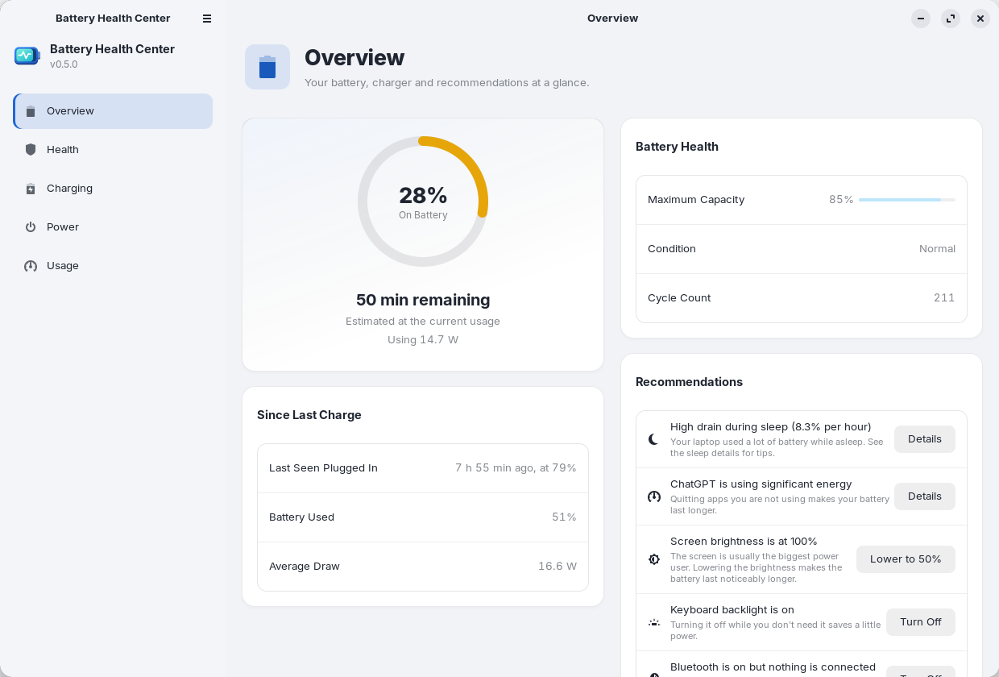

<div align="center">

[English](README.md) · [Español](README.es.md) · **Deutsch** · [Français](README.fr.md) · [简体中文](README.zh-CN.md)


# Battery Health Center

**Alles über den Akku Ihres Laptops an einem Ort.**
Zustand, Ladezyklen, Ladelimits und Ladepläne und welche Apps ihn leeren, für GNOME.

[](https://github.com/arios4k/battery-health-center/releases/latest)
[](https://github.com/arios4k/battery-health-center/actions/workflows/ci.yml)
[](https://arios4k.github.io/battery-health-center/manual/)
[](https://github.com/arios4k/battery-health-center/releases)
[](#installation-ubuntu-debian-und-abkömmlinge)
[](#installation-fedora)
[](https://copr.fedorainfracloud.org/coprs/arios/battery-health-center/builds/)
[](LICENSE)
[](#übersetzungen)
[](#aus-dem-quellcode-bauen)
[](https://paypal.me/AlexisRios)

<picture>
  <source media="(prefers-color-scheme: dark)" srcset="docs/screenshots/v0.5.0/overview-dark.png">
  
</picture>

</div>

## Eine App statt eines Haufens Skripte

Linux liefert die Akkuwerte, aber verstreut: ein Terminal voller `upower`- und `/sys`-Dateien, eine
Shell-Erweiterung für das Ladelimit, `powertop` für Vermutungen über Apps. Battery Health Center fasst sie in
einer nativen GNOME-App zusammen, ähnlich den Akku-Einstellungen von macOS:

| Statt … | bietet Battery Health Center |
|---|---|
| `/sys/class/power_supply` und `upower -i` von Hand zu lesen | **Zustand**: maximale Kapazität im Vergleich zur Nennkapazität, Ladezyklen, Zustand und ein Trend mit dem voraussichtlichen Datum für 80 % |
| einem Skript oder einer Erweiterung für das Ladelimit | **Laden**: Profile per Fingertipp, ein eigenes Limit, ein Ladeplan und optimiertes Laden |
| Raten, welche App den Akku leert | **Nutzung**: Apps nach Energie sortiert, mit geschätzten Watt und einer Stundenansicht für jede |
| dem Durchsuchen von Einstellungen, Optimierungen und Erweiterungen nach Energieoptionen | **Energie**: Energiemodus, automatischer Energiemodus und die Energiespareinstellungen von GNOME auf einer Seite |
| einer Tabelle mit Messwerten | **Berichte**: ein HTML-Akkubericht und CSV-Exporte Ihres Verlaufs |

## Handbuch

**Wie Sie Battery Health Center verwenden, erfahren Sie im [Handbuch von Battery Health Center](https://arios4k.github.io/battery-health-center/manual/)** (auf Englisch). Es erklärt jede Seite Schritt für Schritt: Zustand und Kalibrierung, Ladelimits und den Ladeplan, die Nutzung der Apps, Energiemodi, Benachrichtigungen, Berichte und Ihre Daten, dazu Hilfe bei Problemen und eine Liste der Neuerungen jeder Version. Sie öffnen es auch in der App mit **F1** oder der Hilfe-Schaltfläche.

## Warum Battery Health Center

- **Nativ und leicht.** Rust mit GTK 4 und libadwaita: ein Programm von 1,2 MB (ein Paket von 0,5 MB), heller und
  dunkler Modus, und es folgt Ihrem GNOME-Design.
- **Privat von Grund auf.** Alles bleibt auf Ihrem Computer: Die App verbindet sich nie mit dem Internet und
  hat keine Telemetrie. Der Verlauf besteht aus einigen CSV-Dateien in Ihrem Home-Ordner.
- **Sorgfältig mit Root-Rechten.** Nur ein kleiner Helfer läuft als root. Er akzeptiert nur geprüfte Werte und
  schreibt ausschließlich die Ladelimit-Dateien des Akkus und seine eigene Konfiguration.
- **Spricht Ihre Sprache.** Englisch, Spanisch, Deutsch, Französisch und Vereinfachtes Chinesisch, passend zu Ihrer Systemsprache.
- **Aktualisiert sich mit Ihrem System.** Installieren Sie sie aus einem signierten apt-Repository (oder dem COPR
  von Fedora), und Ihre üblichen Updates halten sie aktuell.

Weitere Antworten, etwa ob das Ladelimit auf Ihrem Laptop funktioniert, finden Sie im Handbuch unter [Troubleshooting and FAQ](https://arios4k.github.io/battery-health-center/manual/troubleshooting.html#faq).

<sub>Screenshots aufgenommen unter Zorin OS 18 mit dem Design ZorinBlue. Erzeugen Sie sie neu mit
`docs/screenshots/capture.sh`.</sub>

## Installation (Ubuntu, Debian und Abkömmlinge)

Für Ubuntu 24.04+, Debian 13+, Linux Mint 22, Zorin OS 18 und andere Abkömmlinge auf 64-Bit-Intel/AMD:

```bash
sudo install -d -m 0755 /etc/apt/keyrings
curl -fsSL https://arios4k.github.io/apt/key.asc | sudo tee /etc/apt/keyrings/battery-health-center.asc > /dev/null
echo "deb [signed-by=/etc/apt/keyrings/battery-health-center.asc] https://arios4k.github.io/apt stable main" | sudo tee /etc/apt/sources.list.d/battery-health-center.list
sudo apt update && sudo apt install battery-health-center
```

Öffnen Sie danach **Battery Health Center** in Ihren Anwendungen. Updates kommen mit `sudo apt upgrade`. Der
Fingerabdruck des Signaturschlüssels lautet `F090 D01D 74F7 14C8 5A95 23CA 4773 367E BD97 6CF5`, und das
Repository (mit Tipps zur Fehlersuche) finden Sie unter [arios4k/apt](https://github.com/arios4k/apt).

## Installation (Fedora)

Für Fedora 43 und neuer auf 64-Bit-Intel/AMD, aus dem [COPR-Repository](https://copr.fedorainfracloud.org/coprs/arios/battery-health-center/):

```bash
sudo dnf copr enable arios/battery-health-center
sudo dnf install battery-health-center
```

Öffnen Sie danach **Battery Health Center** in Ihren Anwendungen. Updates kommen mit `sudo dnf upgrade`. Die
Dienste für Ladelimit und Ladeplan werden bei der Installation eingeschaltet, sodass nichts weiter eingerichtet
werden muss.

## Umstieg vom Snap

Wenn Sie eine ältere Version als Snap installiert haben, entfernen Sie sie zuerst mit
`sudo snap remove battery-health-center`. Das löscht ihren Verlauf, kopieren Sie also vorher
`~/snap/battery-health-center/current/.local/share/battery-health-center/*.csv` nach
`~/.local/share/battery-health-center/`.

## Aus dem Quellcode bauen

Voraussetzungen: Rust, GTK ≥ 4.14, libadwaita ≥ 1.5 und `gettext` für die Übersetzungen.

```bash
sudo apt install libgtk-4-dev libadwaita-1-dev pkg-config gettext   # Debian/Ubuntu
cargo run --release
```

Zum Ändern des Ladelimits wird `pkexec` verwendet, um `bhc-helper` aus dem Build-Ordner zu starten; es fragt
daher jedes Mal nach Ihrem Passwort, bis die App installiert ist. Um sie systemweit zu installieren, führen Sie
`./install.sh` aus (entfernen mit `./install.sh --uninstall`) oder bauen Sie ein Paket mit
`scripts/build-locale.sh && cargo deb`.

Praktisch bei der Entwicklung:

```bash
# eine Übersetzung ausprobieren
scripts/build-locale.sh && LANGUAGE=de BHC_LOCALEDIR=$PWD/locale cargo run --release

# die Ladeplan-Bildschirme ausprobieren, ohne Ihre echten Einstellungen anzufassen: die App auf einen Ordner mit
# einer Ersatz-battery-health-center.conf zeigen lassen (eine Zeile wie "BAT0 75 80") und optional einer
# battery-health-center.schedule und einem unplug-log
BHC_HELPER_FILES=/path/to/folder cargo run --release

# einen Screenshot jeder Seite speichern
BHC_SCREENSHOTS=/path/to/folder cargo run --release
```

## Übersetzungen

Die App ist auf Englisch, Spanisch (`es`), Deutsch (`de`), Französisch (`fr`) und Vereinfachtem Chinesisch (`zh_CN`) verfügbar. Sie verwendet Ihre
Systemsprache und greift für alles Unübersetzte auf Englisch zurück. Der exportierte HTML-Akkubericht ist weiterhin
nur auf Englisch. Diese README und [So funktioniert es](docs/HOW-IT-WORKS.de.md) gibt es auch auf
[English](README.md), [Español](README.es.md), [Français](README.fr.md) und [简体中文](README.zh-CN.md).

Um eine Sprache hinzuzufügen, zum Beispiel Italienisch:

```bash
msginit --locale=it --input=po/battery-health-center.pot --output=po/it.po
```

Übersetzen Sie die Zeichenketten in `po/it.po` (ein PO-Editor wie Poedit oder GNOMEs Gtranslator hilft), fügen
Sie dann `it` zu `po/LINGUAS` hinzu und eine Zeile dafür neben den anderen in `[package.metadata.deb]` in
`Cargo.toml` (die `.mo`-Dateien), und prüfen Sie es mit dem obigen Befehl. Pull Requests mit neuen Sprachen sind
sehr willkommen. `Comment[it]` und `Keywords[it]` in `data/io.github.BatteryHealthCenter.desktop` und ein
`<summary xml:lang="it">` in der Metainfo-Datei übersetzen, wie die App aufgelistet wird.

Wenn sich der Text in der App ändert, aktualisieren Sie die Vorlage und die Übersetzungen (noch nicht übersetzte
Zeichenketten erscheinen leer und werden auf Englisch angezeigt):

```bash
python3 scripts/update-pot.py
msgmerge --update --backup=none po/de.po po/battery-health-center.pot   # und die anderen Sprachen
```

Zeichenketten im Code laufen über `tr("…")`, `trf("… {name}", &[("name", value)])` für Text mit Werten und
`trn`/`trnf` für Plurale; siehe `src/i18n.rs`.

## Weitere Dokumentation

- [Benutzerhandbuch](https://arios4k.github.io/battery-health-center/manual/) (auf Englisch): eine ausführliche Anleitung zu jeder Funktion, mit Screenshots. Öffnen Sie es
  in der App über die Hilfe-Schaltfläche oder `F1`.
- [So funktioniert es](docs/HOW-IT-WORKS.de.md): woher die Zahlen kommen und wie das Ladelimit, der Ladeplan und
  die Energieschätzungen der Apps funktionieren.
- [Wartung und Paketierung](docs/MAINTAINING.md) (auf Englisch): eine Version veröffentlichen, und Hinweise für
  Distributionen, die die App aufnehmen möchten. Sie sind herzlich willkommen, und es wäre mir eine Ehre.
- [Das apt-Repository](https://github.com/arios4k/apt): Installationsschritte, Fehlersuche und wie es gebaut wird.

## Mitwirken

```bash
cargo test
cargo clippy
```

Fehlerberichte, Übersetzungen und Tests auf anderen Laptops und Distributionen sind besonders willkommen:
Bitte [eröffnen Sie ein Issue](https://github.com/arios4k/battery-health-center/issues) mit Ihrem Laptopmodell
und Ihrer Distribution.

## Autor

Erstellt von **Alexis Rios-Negron**.

## Lizenz

GPL-3.0-or-later © Alexis Rios-Negron. Siehe [LICENSE](LICENSE).
