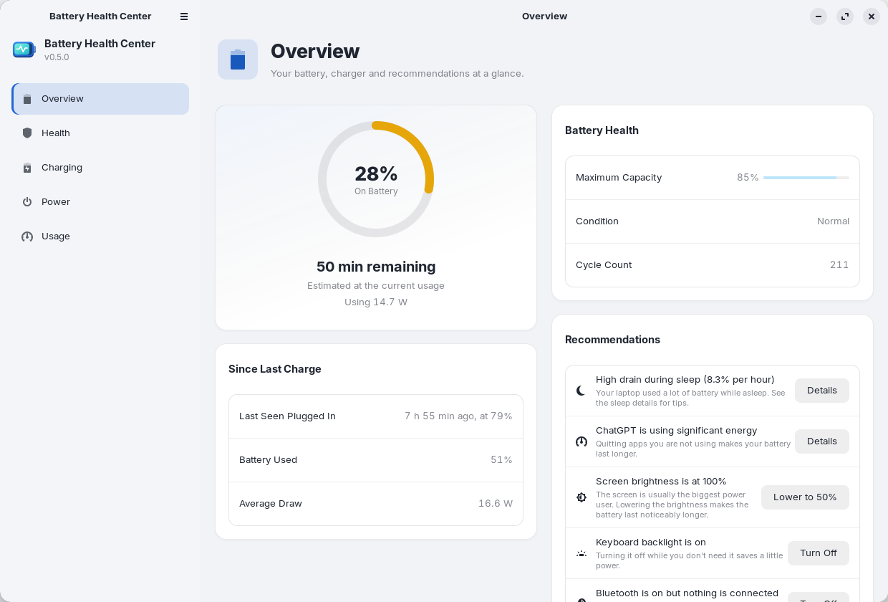

<div align="center">

[English](README.md) · **Español** · [Deutsch](README.de.md) · [Français](README.fr.md) · [简体中文](README.zh-CN.md)


# Battery Health Center

**Todo sobre la batería de tu portátil, en un solo lugar.**
Salud, ciclos, límites y programación de la carga, y qué aplicaciones la gastan, para GNOME.

[](https://github.com/arios4k/battery-health-center/releases/latest)
[](https://github.com/arios4k/battery-health-center/actions/workflows/ci.yml)
[](https://arios4k.github.io/battery-health-center/manual/)
[](https://github.com/arios4k/battery-health-center/releases)
[](#instalación-ubuntu-debian-y-derivadas)
[](#instalación-fedora)
[](https://copr.fedorainfracloud.org/coprs/arios/battery-health-center/builds/)
[](LICENSE)
[](#traducciones)
[](#compilar-desde-el-código-fuente)
[](https://paypal.me/AlexisRios)

<picture>
  <source media="(prefers-color-scheme: dark)" srcset="docs/screenshots/v0.5.0/overview-dark.png">
  
</picture>

</div>

## Una sola aplicación en lugar de un montón de scripts

Linux te da los datos de la batería, pero dispersos: una terminal llena de `upower` y archivos de `/sys`, una
extensión del shell para el límite de carga, `powertop` para adivinar qué aplicaciones gastan. Battery Health
Center los reúne en una aplicación nativa de GNOME, parecida a los ajustes de batería de macOS:

| En lugar de… | Battery Health Center te ofrece |
|---|---|
| leer `/sys/class/power_supply` y `upower -i` a mano | **Salud**: capacidad máxima frente a la capacidad de diseño, ciclos, estado y una tendencia con la fecha prevista para llegar al 80 % |
| un script o una extensión para fijar el límite de carga | **Carga**: perfiles de un toque, un límite personalizado, una programación de carga y la carga optimizada |
| adivinar qué aplicación gasta la batería | **Uso**: aplicaciones ordenadas por energía, con vatios estimados y una vista hora a hora de cada una |
| rebuscar en Ajustes, Retoques y extensiones las opciones de energía | **Energía**: modo de energía, modo automático y los ajustes de ahorro de energía de GNOME en una sola página |
| una hoja de cálculo con mediciones | **Informes**: un informe de batería en HTML y exportaciones CSV de tu historial |

## Manual

**Para aprender a usar Battery Health Center, lee el [manual de Battery Health Center](https://arios4k.github.io/battery-health-center/manual/)** (en inglés). Explica cada página paso a paso: salud y calibración, límites de carga y la programación de la carga, el uso de las aplicaciones, los modos de energía, las notificaciones, los informes y tus datos, con solución de problemas y una lista de las novedades de cada versión. También se abre desde la aplicación con **F1** o el botón de ayuda.

## Por qué Battery Health Center

- **Nativa y ligera.** Rust con GTK 4 y libadwaita: un programa de 1,2 MB (un paquete de 0,5 MB), modo claro y
  oscuro, y sigue tu tema de GNOME.
- **Privada por diseño.** Todo se queda en tu equipo: la aplicación nunca se conecta a internet y no tiene
  telemetría. El historial son unos pocos archivos CSV en tu carpeta personal.
- **Cuidadosa con root.** Solo un pequeño ayudante se ejecuta como root. Acepta únicamente valores validados y
  escribe solo los archivos de límite de carga de la batería y su propia configuración.
- **Habla tu idioma.** Inglés, español, alemán, francés y chino simplificado, según el idioma de tu sistema.
- **Se actualiza con tu sistema.** Instálala desde un repositorio apt firmado (o el COPR de Fedora) y tus
  actualizaciones habituales la mantienen al día.

Encontrarás más respuestas, como si el límite de carga funciona en tu portátil, en [Solución de problemas y preguntas frecuentes](https://arios4k.github.io/battery-health-center/manual/troubleshooting.html#faq) del manual.

<sub>Capturas realizadas en Zorin OS 18 con su tema ZorinBlue. Regénéralas con
`docs/screenshots/capture.sh`.</sub>

## Instalación (Ubuntu, Debian y derivadas)

Para Ubuntu 24.04+, Debian 13+, Linux Mint 22, Zorin OS 18 y otras derivadas, en Intel/AMD de 64 bits:

```bash
sudo install -d -m 0755 /etc/apt/keyrings
curl -fsSL https://arios4k.github.io/apt/key.asc | sudo tee /etc/apt/keyrings/battery-health-center.asc > /dev/null
echo "deb [signed-by=/etc/apt/keyrings/battery-health-center.asc] https://arios4k.github.io/apt stable main" | sudo tee /etc/apt/sources.list.d/battery-health-center.list
sudo apt update && sudo apt install battery-health-center
```

Después abre **Battery Health Center** desde tus aplicaciones. Las actualizaciones llegan con
`sudo apt upgrade`. La huella de la clave de firma es `F090 D01D 74F7 14C8 5A95 23CA 4773 367E BD97 6CF5`, y el
repositorio (con consejos para resolver problemas) está en [arios4k/apt](https://github.com/arios4k/apt).

## Instalación (Fedora)

Para Fedora 43 y posteriores, en Intel/AMD de 64 bits, desde el [repositorio COPR](https://copr.fedorainfracloud.org/coprs/arios/battery-health-center/):

```bash
sudo dnf copr enable arios/battery-health-center
sudo dnf install battery-health-center
```

Después abre **Battery Health Center** desde tus aplicaciones. Las actualizaciones llegan con
`sudo dnf upgrade`. La instalación activa los servicios de límite de carga y programación, así que no hay que
configurar nada más.

## Si vienes del snap

Si instalaste una versión anterior como snap, quítala primero con `sudo snap remove battery-health-center`. Eso
borra su historial, así que copia `~/snap/battery-health-center/current/.local/share/battery-health-center/*.csv`
a `~/.local/share/battery-health-center/` antes de hacerlo.

## Compilar desde el código fuente

Requisitos: Rust, GTK ≥ 4.14, libadwaita ≥ 1.5 y `gettext` para las traducciones.

```bash
sudo apt install libgtk-4-dev libadwaita-1-dev pkg-config gettext   # Debian/Ubuntu
cargo run --release
```

Cambiar el límite de carga usa `pkexec` para ejecutar `bhc-helper` desde la carpeta de compilación, así que pide
tu contraseña cada vez hasta que la aplicación esté instalada. Para instalarla en todo el sistema, ejecuta
`./install.sh` (quítala con `./install.sh --uninstall`), o construye un paquete con
`scripts/build-locale.sh && cargo deb`.

Útil durante el desarrollo:

```bash
# probar una traducción
scripts/build-locale.sh && LANGUAGE=es BHC_LOCALEDIR=$PWD/locale cargo run --release

# probar las pantallas de la programación de la carga sin tocar tus ajustes reales: apunta la aplicación a una
# carpeta con un battery-health-center.conf de prueba (una línea como "BAT0 75 80") y, opcionalmente, un
# battery-health-center.schedule y un unplug-log
BHC_HELPER_FILES=/path/to/folder cargo run --release

# guardar una captura de cada página
BHC_SCREENSHOTS=/path/to/folder cargo run --release
```

## Traducciones

La aplicación está disponible en inglés, español (`es`), alemán (`de`), francés (`fr`) y chino simplificado (`zh_CN`). Usa el idioma de tu
sistema y recurre al inglés para lo que no esté traducido. El informe de batería HTML exportado sigue estando
solo en inglés. Este README y [Cómo funciona](docs/HOW-IT-WORKS.es.md) también están disponibles en
[English](README.md), [Deutsch](README.de.md), [Français](README.fr.md) y [简体中文](README.zh-CN.md).

Para añadir un idioma, por ejemplo italiano:

```bash
msginit --locale=it --input=po/battery-health-center.pot --output=po/it.po
```

Traduce las cadenas de `po/it.po` (ayuda un editor de PO como Poedit o Gtranslator de GNOME), luego añade `it` a
`po/LINGUAS` y una línea para él junto a las demás en `[package.metadata.deb]` de `Cargo.toml` (los archivos
`.mo`), y compruébalo con el comando anterior. Los pull requests con idiomas nuevos son muy bienvenidos.
`Comment[it]` y `Keywords[it]` en `data/io.github.BatteryHealthCenter.desktop` y un `<summary xml:lang="it">` en
el archivo metainfo traducen cómo se presenta la aplicación.

Cuando cambia el texto de la aplicación, actualiza la plantilla y las traducciones (las cadenas sin traducir
aparecen vacías y se muestran en inglés):

```bash
python3 scripts/update-pot.py
msgmerge --update --backup=none po/es.po po/battery-health-center.pot   # y los demás idiomas
```

Las cadenas del código pasan por `tr("…")`, `trf("… {name}", &[("name", value)])` para texto con valores, y
`trn`/`trnf` para plurales; consulta `src/i18n.rs`.

## Más documentación

- [Manual de usuario](https://arios4k.github.io/battery-health-center/manual/) (en inglés): una guía detallada de cada función, con capturas de pantalla. Ábrelo desde la
  aplicación con el botón de ayuda o `F1`.
- [Cómo funciona](docs/HOW-IT-WORKS.es.md): de dónde salen los datos, cómo funcionan el límite de carga, la
  programación y las estimaciones de energía de las aplicaciones.
- [Mantenimiento y empaquetado](docs/MAINTAINING.md) (en inglés): publicar una versión y notas para las
  distribuciones que quieran incluir la aplicación. Serán bienvenidas y me sentiría honrado.
- [El repositorio apt](https://github.com/arios4k/apt): pasos de instalación, solución de problemas y cómo se
  construye.

## Contribuir

```bash
cargo test
cargo clippy
```

Los informes de errores, las traducciones y las pruebas en otros portátiles y distribuciones son especialmente
bienvenidos: por favor [abre una incidencia](https://github.com/arios4k/battery-health-center/issues) con el
modelo de tu portátil y tu distribución.

## Autor

Creado por **Alexis Rios-Negron**.

## Licencia

GPL-3.0-or-later © Alexis Rios-Negron. Consulta [LICENSE](LICENSE).
