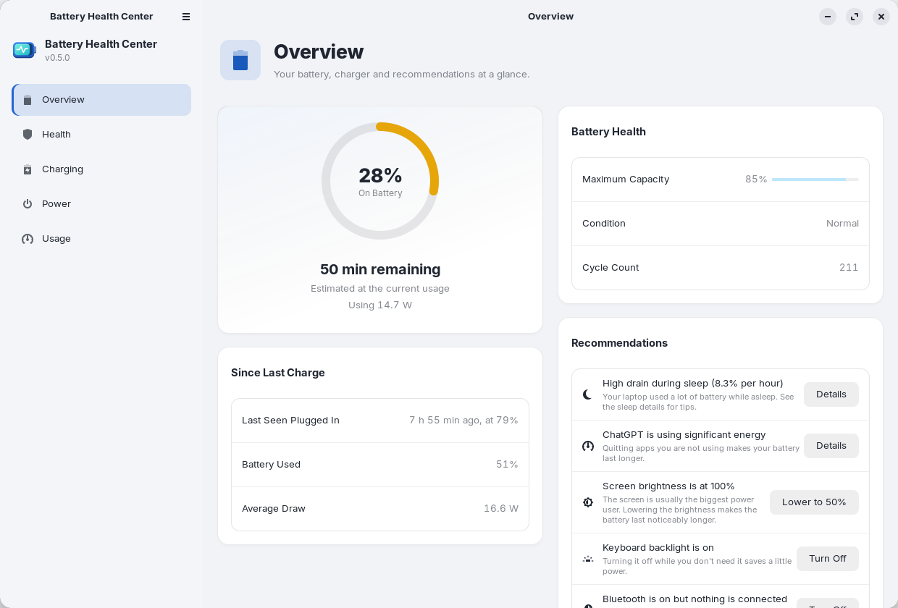
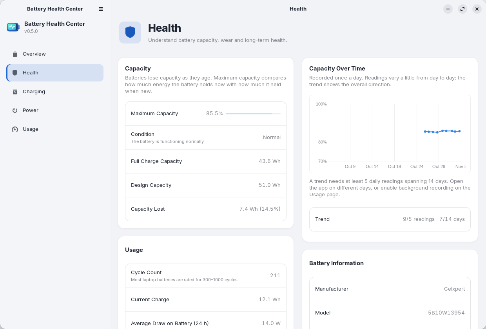
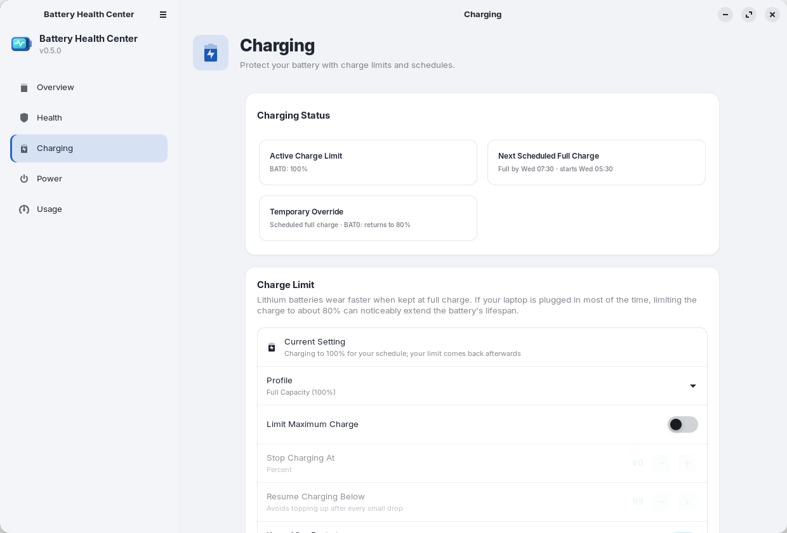
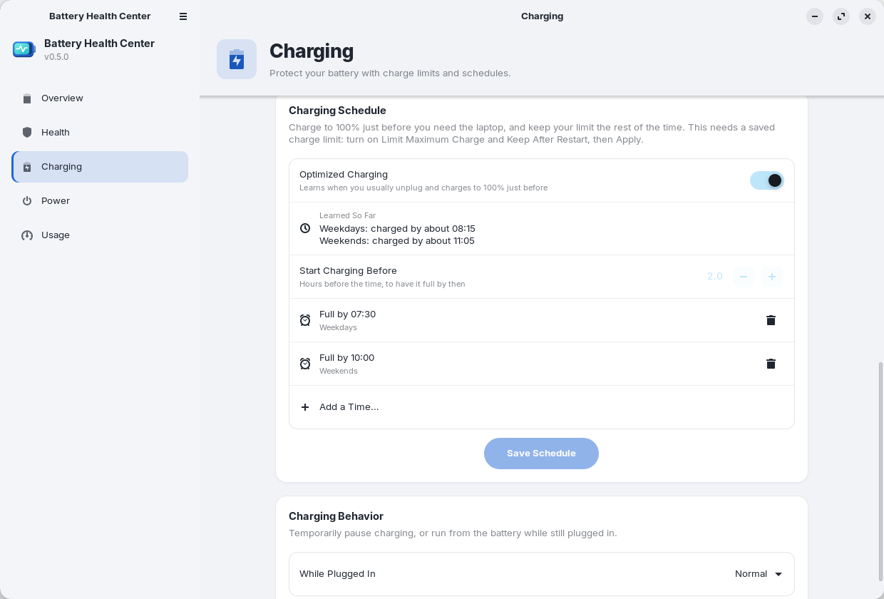
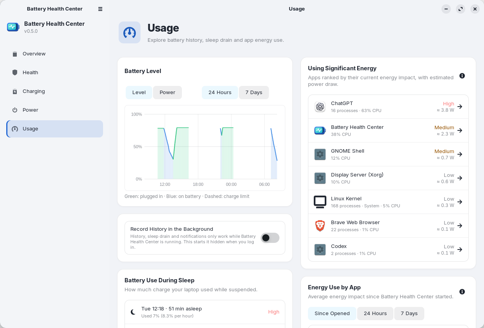
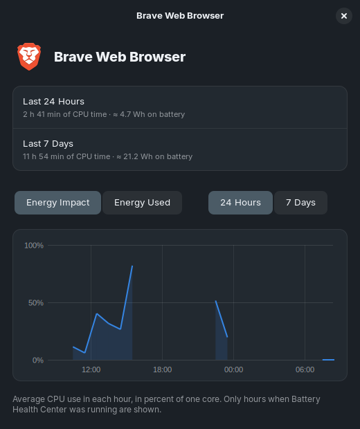
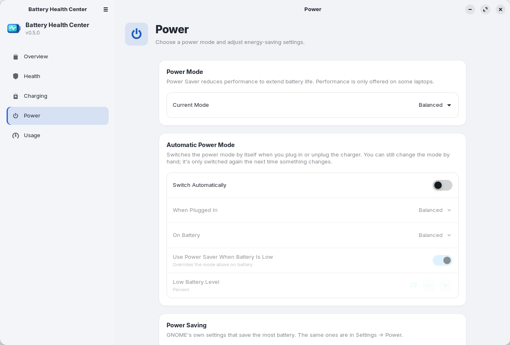

<div align="center">

[English](README.md) · [Español](README.es.md) · [Deutsch](README.de.md) · **Français**


# Battery Health Center

**Tout sur la batterie de votre ordinateur portable, au même endroit.**
Santé, nombre de cycles, limites et programmation de la charge, et applications qui la vident, pour GNOME.

[](https://github.com/arios4k/battery-health-center/releases/latest)
[](https://github.com/arios4k/battery-health-center/actions/workflows/ci.yml)
[](#installation-ubuntu-debian-et-dérivées)
[](#installation-fedora)
[](LICENSE)
[](#traductions)
[](#compiler-depuis-les-sources)

<picture>
  <source media="(prefers-color-scheme: dark)" srcset="docs/screenshots/v0.5.0/overview-dark.png">
  
</picture>

</div>

## Une seule application au lieu d’un tas de scripts

Linux fournit les chiffres de la batterie, mais éparpillés : un terminal plein de `upower` et de fichiers
`/sys`, une extension du shell pour la limite de charge, `powertop` pour deviner quelles applications
consomment. Battery Health Center les réunit dans une application GNOME native, un peu comme les réglages de
batterie de macOS :

| Au lieu de… | Battery Health Center vous offre |
|---|---|
| lire `/sys/class/power_supply` et `upower -i` à la main | **Santé** : capacité maximale par rapport à la capacité d’origine, nombre de cycles, état, et une tendance avec la date prévue pour atteindre 80 % |
| un script ou une extension pour fixer la limite de charge | **Charge** : des profils en un geste, une limite personnalisée, une programmation de la charge et la charge optimisée |
| deviner quelle application vide la batterie | **Utilisation** : les applications classées par énergie, avec la puissance estimée en watts et une vue heure par heure pour chacune |
| fouiller Paramètres, Ajustements et les extensions pour les options d’énergie | **Énergie** : mode d’alimentation, mode automatique et réglages d’économie d’énergie de GNOME sur une seule page |
| un tableur de mesures | **Rapports** : un rapport de batterie HTML et des exports CSV de votre historique |

## Fonctionnalités

### 🔋 Sachez vraiment dans quel état est votre batterie

La capacité maximale comparée à celle de la batterie neuve, son état (Normal, Usée ou Remplacement conseillé),
le nombre de cycles, la tension, le fabricant, le modèle et la chimie. La capacité est enregistrée une fois par
jour : au bout d’environ deux semaines, vous obtenez une tendance et la date prévue pour atteindre 80 %. Si le
pourcentage fait des sauts ou si l’ordinateur s’éteint trop tôt, un calibrage guidé (charger, décharger presque
complètement, recharger) corrige la mesure. Les ordinateurs à deux batteries sont pris en charge.

<picture>
  <source media="(prefers-color-scheme: dark)" srcset="docs/screenshots/v0.5.0/health-dark.png">
  
</picture>

### 🛡️ Faites durer la batterie des années

Les batteries au lithium s’usent plus vite lorsqu’elles restent à 100 %. Choisissez un profil, **Durée de vie
maximale (60 %)**, **Équilibré (80 %)** ou **Pleine capacité (100 %)**, ou fixez précisément où la charge
s’arrête et reprend. La limite est conservée après les redémarrages et la mise en veille. Besoin d’une batterie
pleine pour un voyage ? **Charger à 100 % maintenant** charge complètement une seule fois, puis votre limite
revient toute seule.

<picture>
  <source media="(prefers-color-scheme: dark)" srcset="docs/screenshots/v0.5.0/charging-dark.png">
  
</picture>

### 🗓️ Pleine quand il le faut, protégée le reste du temps

Dites quand vous avez besoin de l’ordinateur, par exemple **en semaine à 7 h 30** : la limite est levée peu
avant pour que la batterie soit pleine à l’heure, puis rétablie. Ou activez la **charge optimisée** : elle
apprend votre routine d’après les moments où vous débranchez d’habitude. Vous saisissez votre mot de passe une
seule fois, à l’enregistrement de la programmation ; un petit service fait le reste.

<picture>
  <source media="(prefers-color-scheme: dark)" srcset="docs/screenshots/v0.5.0/schedule-dark.png">
  
</picture>

### 📊 Voyez ce qui la vide

Niveau de batterie et consommation électrique sur la dernière journée ou la dernière semaine, consommation de la
batterie pendant la veille de l’ordinateur (avec un avertissement lorsqu’elle est anormalement élevée), et les
applications qui consomment le plus d’énergie en ce moment, depuis l’ouverture de l’application, ou sur 24 heures
et 7 jours. Cliquez sur une application pour voir son impact énergétique et son utilisation estimée heure par
heure. Linux ne mesure pas la puissance par application : les chiffres sont des estimations calculées à partir du
temps processeur et de la consommation mesurée au-dessus du repos.

<picture>
  <source media="(prefers-color-scheme: dark)" srcset="docs/screenshots/v0.5.0/usage-dark.png">
  
</picture>

<div align="center">

</div>

### ⚡ Les modes d’alimentation sans les chercher

Économie d’énergie, Équilibré ou Performances, avec un **mode d’alimentation automatique** qui change quand vous
branchez ou débranchez le chargeur, plus les réglages d’économie d’énergie de GNOME (assombrissement de l’écran,
extinction de l’écran, mise en veille automatique, bouton d’alimentation et capot) et le pourcentage de batterie
dans la barre supérieure. Seul ce que votre matériel prend en charge est affiché.

<picture>
  <source media="(prefers-color-scheme: dark)" srcset="docs/screenshots/v0.5.0/power-dark.png">
  
</picture>

### 💡 De petits coups de pouce, sans harcèlement

Sur batterie, la Vue d’ensemble peut vous suggérer de baisser un écran très lumineux, d’éteindre le
rétroéclairage du clavier ou de désactiver le Bluetooth quand rien n’est connecté, chaque fois avec un bouton.
Des notifications vous préviennent quand la limite de charge est atteinte, quand la batterie est pleine sans
limite, quand elle est faible, quand une application la vide et quand l’ordinateur a beaucoup consommé en veille.
Vous pouvez les désactiver dans les Préférences (sauf les étapes du calibrage).

### 📤 Emportez vos données

Exportez un rapport de batterie HTML (pour une demande de garantie, ou à la revente de l’ordinateur) depuis le
menu, ou lancez `battery-health-center --export-report report.html`. **Exporter les données en CSV** (ou
`battery-health-center --export-csv <dossier>`) écrit l’historique de la batterie, la capacité au fil du temps,
les sessions de veille et la consommation d’énergie de chaque application par heure sous forme de fichiers CSV
pour un tableur.

## Pourquoi Battery Health Center

- **Natif et léger.** Rust avec GTK 4 et libadwaita : un programme de 1,2 Mo (un paquet de 0,5 Mo), mode clair et
  sombre, et il suit votre thème GNOME.
- **Respectueux de la vie privée.** Tout reste sur votre ordinateur : l’application ne se connecte jamais à
  internet et n’a aucune télémétrie. L’historique tient dans quelques fichiers CSV de votre dossier personnel.
- **Prudent avec root.** Seul un petit assistant s’exécute en tant que root. Il n’accepte que des valeurs
  validées et n’écrit que les fichiers de limite de charge de la batterie et sa propre configuration.
- **Parle votre langue.** Anglais, espagnol, allemand et français, selon la langue de votre système.
- **Se met à jour avec votre système.** Installez-le depuis un dépôt apt signé (ou le COPR de Fedora) et vos
  mises à jour habituelles le tiennent à jour.

## FAQ

**La limite de charge fonctionnera-t-elle sur mon ordinateur ?**
Les informations sur la batterie fonctionnent sur tout ordinateur portable doté d’un pilote de batterie Linux
standard. Les limites de charge nécessitent une prise en charge du micrologiciel que le noyau expose sous le nom
`charge_control_end_threshold` (ou `charge_stop_threshold`), comme sur les ThinkPad et de nombreux ordinateurs
ASUS, Dell, Huawei, LG, Samsung et System76. Si le vôtre n’en dispose pas, la page Charge l’indique et tout le
reste fonctionne quand même.

**Quels bureaux et quelles distributions ?**
Il est développé et testé sur GNOME : Ubuntu 24.04, Zorin OS 18 et Linux Mint 22. Le paquet nécessite GTK 4.14
et libadwaita 1.5 ou plus récents ; Ubuntu 22.04, Debian 12 et Mint 21 sont donc trop anciens. La page Énergie
utilise les réglages propres à GNOME : c’est la partie la plus liée à GNOME.

**Est-il sans danger de modifier la limite de charge ?**
Elle fixe les mêmes seuils du micrologiciel que ceux utilisés par d’autres outils et options du BIOS, et
**Pleine capacité (100 %)** supprime de nouveau la limite. La modification demande votre mot de passe.

**Dois-je laisser l’application ouverte ?**
L’historique, la décharge en veille et les notifications sont enregistrés tant que l’application fonctionne. À
la première ouverture, elle demande si elle doit **enregistrer l’historique en arrière-plan** ; répondez oui et
elle démarre masquée à l’ouverture de session. Vous pouvez changer d’avis à tout moment sur la page Utilisation.

<sub>Captures d’écran réalisées sur Zorin OS 18 avec son thème ZorinBlue. Régénérez-les avec
`docs/screenshots/capture.sh`.</sub>

## Installation (Ubuntu, Debian et dérivées)

Pour Ubuntu 24.04+, Debian 13+, Linux Mint 22, Zorin OS 18 et autres dérivées, sur Intel/AMD 64 bits :

```bash
sudo install -d -m 0755 /etc/apt/keyrings
curl -fsSL https://arios4k.github.io/apt/key.asc | sudo tee /etc/apt/keyrings/battery-health-center.asc > /dev/null
echo "deb [signed-by=/etc/apt/keyrings/battery-health-center.asc] https://arios4k.github.io/apt stable main" | sudo tee /etc/apt/sources.list.d/battery-health-center.list
sudo apt update && sudo apt install battery-health-center
```

Ouvrez ensuite **Battery Health Center** depuis vos applications. Les mises à jour arrivent avec
`sudo apt upgrade`. L’empreinte de la clé de signature est `F090 D01D 74F7 14C8 5A95 23CA 4773 367E BD97 6CF5`,
et le dépôt (avec des conseils de dépannage) se trouve sur [arios4k/apt](https://github.com/arios4k/apt).

## Installation (Fedora)

Pour Fedora 43 et suivantes, sur Intel/AMD 64 bits, depuis le [dépôt COPR](https://copr.fedorainfracloud.org/coprs/arios/battery-health-center/) :

```bash
sudo dnf copr enable arios/battery-health-center
sudo dnf install battery-health-center
```

Ouvrez ensuite **Battery Health Center** depuis vos applications. Les mises à jour arrivent avec
`sudo dnf upgrade`. Les services de limite de charge et de programmation sont activés par l’installation : il n’y
a rien d’autre à configurer.

## Passer depuis le snap

Si vous avez installé une ancienne version sous forme de snap, supprimez-la d’abord avec
`sudo snap remove battery-health-center`. Cela efface son historique : copiez donc
`~/snap/battery-health-center/current/.local/share/battery-health-center/*.csv` vers
`~/.local/share/battery-health-center/` avant de le faire.

## Compiler depuis les sources

Prérequis : Rust, GTK ≥ 4.14, libadwaita ≥ 1.5, et `gettext` pour les traductions.

```bash
sudo apt install libgtk-4-dev libadwaita-1-dev pkg-config gettext   # Debian/Ubuntu
cargo run --release
```

Changer la limite de charge utilise `pkexec` pour lancer `bhc-helper` depuis le dossier de compilation : il
demande donc votre mot de passe à chaque fois tant que l’application n’est pas installée. Pour l’installer pour
tout le système, lancez `./install.sh` (supprimez-la avec `./install.sh --uninstall`), ou construisez un paquet
avec `scripts/build-locale.sh && cargo deb`.

Pratique pendant le développement :

```bash
# essayer une traduction
scripts/build-locale.sh && LANGUAGE=fr BHC_LOCALEDIR=$PWD/locale cargo run --release

# essayer les écrans de programmation de la charge sans toucher à vos vrais réglages : pointez l’application vers
# un dossier contenant un battery-health-center.conf factice (une ligne comme « BAT0 75 80 »), et
# éventuellement un battery-health-center.schedule et un unplug-log
BHC_HELPER_FILES=/path/to/folder cargo run --release

# enregistrer une capture d’écran de chaque page
BHC_SCREENSHOTS=/path/to/folder cargo run --release
```

## Traductions

L’application est disponible en anglais, espagnol (`es`), allemand (`de`) et français (`fr`). Elle utilise la
langue de votre système et revient à l’anglais pour tout ce qui n’est pas traduit. Le rapport de batterie HTML
exporté reste uniquement en anglais. Ce README et [Comment ça marche](docs/HOW-IT-WORKS.fr.md) existent aussi en
[English](README.md), [Español](README.es.md) et [Deutsch](README.de.md).

Pour ajouter une langue, par exemple l’italien :

```bash
msginit --locale=it --input=po/battery-health-center.pot --output=po/it.po
```

Traduisez les chaînes de `po/it.po` (un éditeur PO comme Poedit ou Gtranslator de GNOME aide), puis ajoutez `it`
à `po/LINGUAS` et une ligne pour cette langue à côté des autres dans `[package.metadata.deb]` de `Cargo.toml`
(les fichiers `.mo`), et vérifiez avec la commande ci-dessus. Les pull requests ajoutant de nouvelles langues
sont les bienvenues. `Comment[it]` et `Keywords[it]` dans `data/io.github.BatteryHealthCenter.desktop` et un
`<summary xml:lang="it">` dans le fichier metainfo traduisent la façon dont l’application est présentée.

Quand le texte de l’application change, mettez à jour le modèle et les traductions (les chaînes pas encore
traduites apparaissent vides et s’affichent en anglais) :

```bash
python3 scripts/update-pot.py
msgmerge --update --backup=none po/fr.po po/battery-health-center.pot   # et les autres langues
```

Les chaînes du code passent par `tr("…")`, `trf("… {name}", &[("name", value)])` pour le texte avec des valeurs,
et `trn`/`trnf` pour les pluriels ; voir `src/i18n.rs`.

## Plus de documentation

- [Comment ça marche](docs/HOW-IT-WORKS.fr.md) : d’où viennent les chiffres, comment fonctionnent la limite de
  charge, la programmation et les estimations d’énergie des applications.
- [Maintenance et empaquetage](docs/MAINTAINING.md) (en anglais) : publier une version, et notes pour les
  distributions qui veulent inclure l’application. Vous y êtes les bienvenus, et j’en serais honoré.
- [Le dépôt apt](https://github.com/arios4k/apt) : étapes d’installation, dépannage et fonctionnement.

## Contribuer

```bash
cargo test
cargo clippy
```

Les rapports de bogues, les traductions et les tests sur d’autres ordinateurs et distributions sont
particulièrement bienvenus : [ouvrez un ticket](https://github.com/arios4k/battery-health-center/issues) en
indiquant le modèle de votre ordinateur et votre distribution.

## Auteur

Créé par **Alexis Rios-Negron**.

## Licence

GPL-3.0-or-later © Alexis Rios-Negron. Voir [LICENSE](LICENSE).
