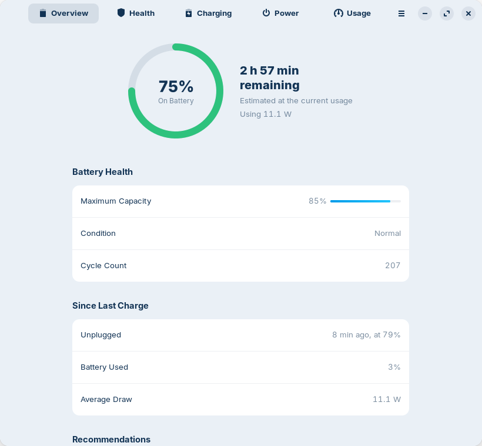
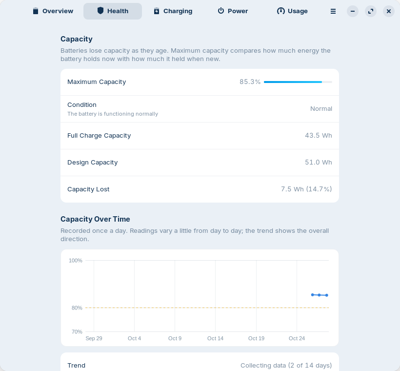
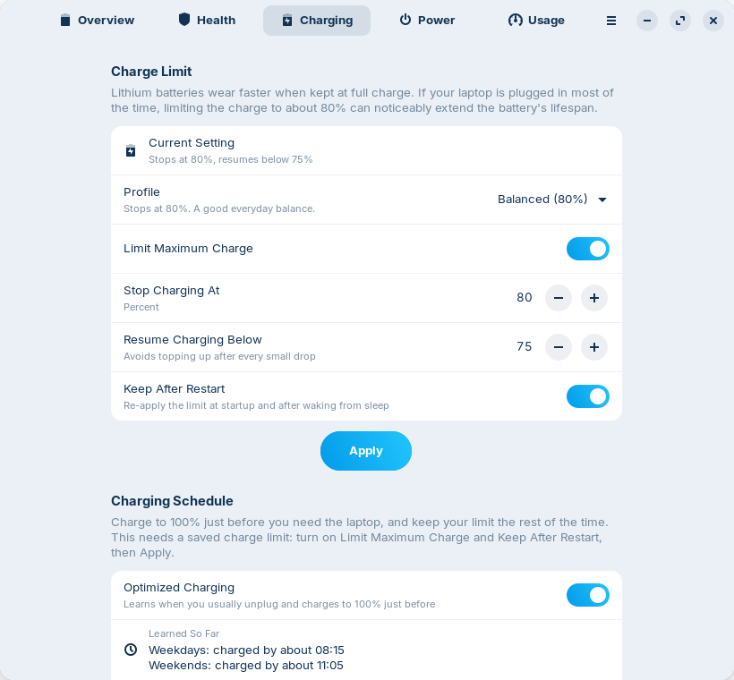
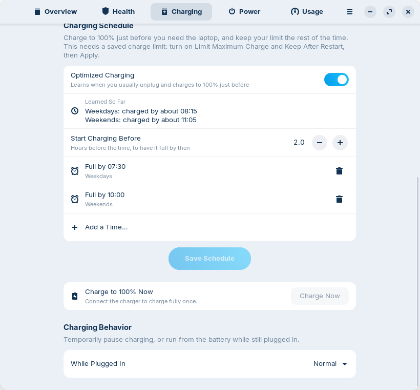
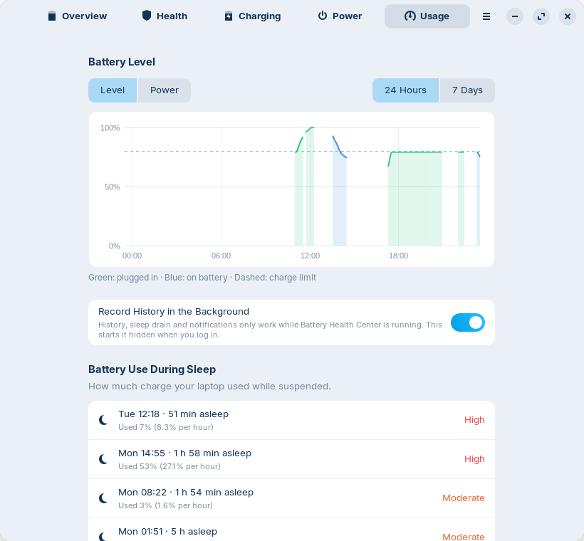
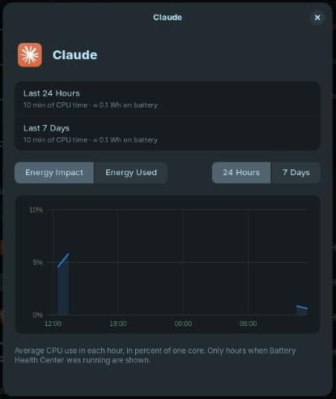
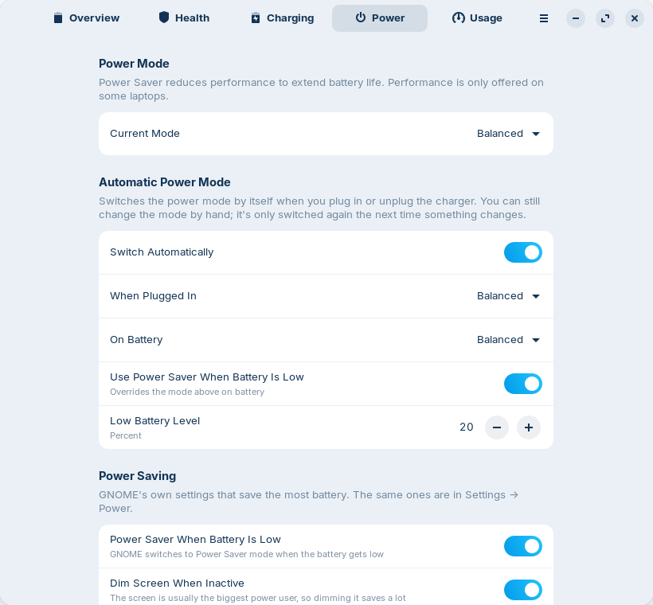

<div align="center">


# Battery Health Center

**Everything about your laptop battery, in one place.**
Health, cycle count, charge limits and schedules, and which apps drain it, for GNOME.

[](#install-ubuntu-debian-and-derivatives)
[](LICENSE)
[](#translations)
[](#build-from-source)

<picture>
  <source media="(prefers-color-scheme: dark)" srcset="docs/screenshots/overview-dark.png">
  
</picture>

</div>

## One app instead of a pile of scripts

Linux gives you the battery numbers, but scattered: a terminal full of `upower` and `/sys` files, a
shell extension for the charge limit, `powertop` for guesses about apps. Battery Health Center puts them
in one native GNOME app, much like the Battery settings on macOS:

| Instead of… | Battery Health Center gives you |
|---|---|
| reading `/sys/class/power_supply` and `upower -i` by hand | **Health**: maximum capacity against design capacity, cycle count, condition, and a trend with a projected 80% date |
| a script or extension to set the charge limit | **Charging**: one-tap profiles, a custom limit, a charging schedule and optimized charging |
| guessing which app drains the battery | **Usage**: apps ranked by energy, with estimated watts and an hour-by-hour view for each |
| digging through Settings, Tweaks and extensions for power options | **Power**: power mode, automatic power mode and GNOME's power-saving settings on one page |
| a spreadsheet of readings | **Reports**: an HTML battery report and CSV exports of your history |

## Features

### 🔋 Know how healthy your battery really is

Maximum capacity compared with when the battery was new, its condition (Normal, Worn or Service
Recommended), cycle count, voltage, manufacturer, model and chemistry. Capacity is logged once a day, so
after about two weeks you get a trend and the date it is projected to reach 80%. If the percentage jumps
or the laptop shuts down early, a guided calibration (charge, run nearly empty, charge again) fixes the
reading. Laptops with two batteries are supported.

<picture>
  <source media="(prefers-color-scheme: dark)" srcset="docs/screenshots/health-dark.png">
  
</picture>

### 🛡️ Make the battery last for years

Lithium batteries wear faster when they sit at 100%. Pick a profile, **Maximum Lifespan (60%)**,
**Balanced (80%)** or **Full Capacity (100%)**, or set exactly where charging stops and resumes. The limit
is kept after restarts and sleep. Need a full battery for a trip? **Charge to 100% Now** charges fully
once, then your limit comes back by itself.

<picture>
  <source media="(prefers-color-scheme: dark)" srcset="docs/screenshots/charging-dark.png">
  
</picture>

### 🗓️ Full when you need it, protected the rest of the time

Tell it when you need the laptop, for example **weekdays at 07:30**, and the limit is lifted shortly
before so the battery is full on time, then put back. Or turn on **optimized charging** and it learns
your routine from when you usually unplug. You enter your password once, when you save the schedule; a
small service does the rest.

<picture>
  <source media="(prefers-color-scheme: dark)" srcset="docs/screenshots/schedule-dark.png">
  
</picture>

### 📊 See what is draining it

Battery level and power draw for the last day or week, battery use while the laptop slept (with a warning
when it is unusually high), and the apps using the most energy right now, since you opened the app, or
over 24 hours and 7 days. Click an app to see its energy impact and estimated use hour by hour. Linux
doesn't measure power per app, so the numbers are estimates from CPU time and the measured draw above idle.

<picture>
  <source media="(prefers-color-scheme: dark)" srcset="docs/screenshots/usage-dark.png">
  
</picture>

<div align="center">

</div>

### ⚡ Power modes without the hunt

Power Saver, Balanced or Performance, with an **automatic power mode** that switches when you plug in or
unplug the charger, plus GNOME's power-saving settings (dim screen, screen blank, automatic suspend,
power button and lid) and the battery percentage in the top bar. Only what your hardware supports is
shown.

<picture>
  <source media="(prefers-color-scheme: dark)" srcset="docs/screenshots/power-dark.png">
  
</picture>

### 💡 Small nudges, not nagging

While you are on battery, the Overview can suggest turning down a very bright screen, switching off the
keyboard backlight, or turning off Bluetooth when nothing is connected, each with a button. Notifications
tell you when the charge limit is reached, when you are fully charged without a limit, when the battery is
low, when an app is draining it, and when the laptop used a lot of battery asleep. You can turn them
off in Preferences (the calibration steps excepted).

### 📤 Take your data with you

Export an HTML battery report (for a warranty claim, or when you sell the laptop) from the menu, or run
`battery-health-center --export-report report.html`. **Export Data as CSV** (or
`battery-health-center --export-csv <folder>`) writes the battery history, capacity over time, sleep
sessions and each app's energy use per hour as CSV files for a spreadsheet.

## Why Battery Health Center

- **Native and light.** Rust with GTK 4 and libadwaita: a 1.2 MB program (a 0.5 MB package), light and
  dark mode, and it follows your GNOME theme.
- **Private by design.** Everything stays on your computer: the app never connects to the internet and
  has no telemetry. The history is a few CSV files in your home folder.
- **Careful with root.** Only a small helper runs as root. It accepts nothing but validated values and
  writes only the battery's charge-limit files and its own config.
- **Speaks your language.** English, Spanish and German, following your system language.
- **Updates with your system.** Install it from a signed apt repository and `apt upgrade` keeps it current.

## FAQ

**Will the charge limit work on my laptop?**
Battery information works on any laptop with a standard Linux battery driver. Charge limits need firmware
support that the kernel exposes as `charge_control_end_threshold` (or `charge_stop_threshold`), as on
ThinkPads and many ASUS, Dell, Huawei, LG, Samsung and System76 laptops. If yours doesn't have it, the
Charging page says so and everything else still works.

**Which desktops and distributions?**
It is developed and tested on GNOME: Ubuntu 24.04, Zorin OS 18 and Linux Mint 22. The package needs
GTK 4.14 and libadwaita 1.5 or newer, so Ubuntu 22.04, Debian 12 and Mint 21 are too old. The Power page
uses GNOME's own settings, so it is the part most tied to GNOME.

**Is it safe to change the charge limit?**
It sets the same firmware thresholds that other tools and BIOS options use, and **Full Capacity (100%)**
removes the limit again. Changing it asks for your password.

**Do I have to keep the app open?**
History, sleep drain and notifications are recorded while the app runs. Turn on **Record History in the
Background** on the Usage page and it starts hidden when you log in.

<sub>Screenshots taken on Zorin OS 18 with its ZorinBlue theme. Regenerate them with
`docs/screenshots/capture.sh`.</sub>

## Install (Ubuntu, Debian and derivatives)

For Ubuntu 24.04+, Debian 13+, Linux Mint 22,
Zorin OS 18 and other derivatives on 64-bit Intel/AMD:

```bash
sudo install -d -m 0755 /etc/apt/keyrings
curl -fsSL https://arios4k.github.io/apt/key.asc | sudo tee /etc/apt/keyrings/battery-health-center.asc > /dev/null
echo "deb [signed-by=/etc/apt/keyrings/battery-health-center.asc] https://arios4k.github.io/apt stable main" | sudo tee /etc/apt/sources.list.d/battery-health-center.list
sudo apt update && sudo apt install battery-health-center
```

Then open **Battery Health Center** from your applications. Updates arrive with `sudo apt upgrade`. The
signing key's fingerprint is `F090 D01D 74F7 14C8 5A95 23CA 4773 367E BD97 6CF5`, and the repository
(with troubleshooting tips) lives at [arios4k/apt](https://github.com/arios4k/apt).

If you installed an older version as a snap, remove it first with `sudo snap remove battery-health-center`.
That deletes its history, so copy `~/snap/battery-health-center/current/.local/share/battery-health-center/*.csv`
to `~/.local/share/battery-health-center/` before you do.

## Build from source

Requirements: Rust, GTK ≥ 4.14, libadwaita ≥ 1.5, and `gettext` for the translations.

```bash
sudo apt install libgtk-4-dev libadwaita-1-dev pkg-config gettext   # Debian/Ubuntu
cargo run --release
```

Changing the charge limit uses `pkexec` to run `bhc-helper` from the build folder, so it asks for your
password every time until the app is installed. To install it system-wide, run `./install.sh` (remove it
with `./install.sh --uninstall`), or build a package with `scripts/build-locale.sh && cargo deb`.

Handy while developing:

```bash
# try a translation
scripts/build-locale.sh && LANGUAGE=es BHC_LOCALEDIR=$PWD/locale cargo run --release

# try the Charging Schedule screens without touching your real settings: point the app at a folder with
# a stand-in battery-health-center.conf (a line like "BAT0 75 80"), and optionally a
# battery-health-center.schedule and an unplug-log
BHC_HELPER_FILES=/path/to/folder cargo run --release

# save a screenshot of every page
BHC_SCREENSHOTS=/path/to/folder cargo run --release
```

## Translations

The app is available in English, Spanish (`es`) and German (`de`). It uses your system language and
falls back to English for anything that isn't translated. The exported HTML battery report is still
English only.

To add a language, for example French:

```bash
msginit --locale=fr --input=po/battery-health-center.pot --output=po/fr.po
```

Translate the strings in `po/fr.po` (a PO editor such as Poedit or GNOME's Gtranslator helps), then add
`fr` to `po/LINGUAS` and a line for it next to the others in `[package.metadata.deb]` in `Cargo.toml`
(the `.mo` assets), and check it with the command above. Pull requests with new languages are very
welcome. `Comment[fr]` and `Keywords[fr]` in `data/io.github.BatteryHealthCenter.desktop` and a
`<summary xml:lang="fr">` in the metainfo file translate how the app is listed.

When the text in the app changes, update the template and the translations (strings that haven't been
translated yet show up as empty and are shown in English):

```bash
python3 scripts/update-pot.py
msgmerge --update --backup=none po/es.po po/battery-health-center.pot   # and the other languages
```

Strings in the code go through `tr("…")`, `trf("… {name}", &[("name", value)])` for text with values
in it, and `trn`/`trnf` for plurals; see `src/i18n.rs`.

## More documentation

- [How it works](docs/HOW-IT-WORKS.md): where the numbers come from, how the charge limit, the schedule
  and the app energy estimates work.
- [Maintaining and packaging](docs/MAINTAINING.md): publishing a release, and notes for distributions that
  want to include the app. You are welcome to, and I would be honored.
- [The apt repository](https://github.com/arios4k/apt): install steps, troubleshooting and how it is built.

## Contributing

```bash
cargo test
cargo clippy
```

Bug reports, translations and testing on other laptops and distributions are especially welcome: please
[open an issue](https://github.com/arios4k/battery-health-center/issues) with your laptop model and
distribution.

## Author

Created by **Alexis Rios-Negron**.

## License

GPL-3.0-or-later © Alexis Rios-Negron. See [LICENSE](LICENSE).
