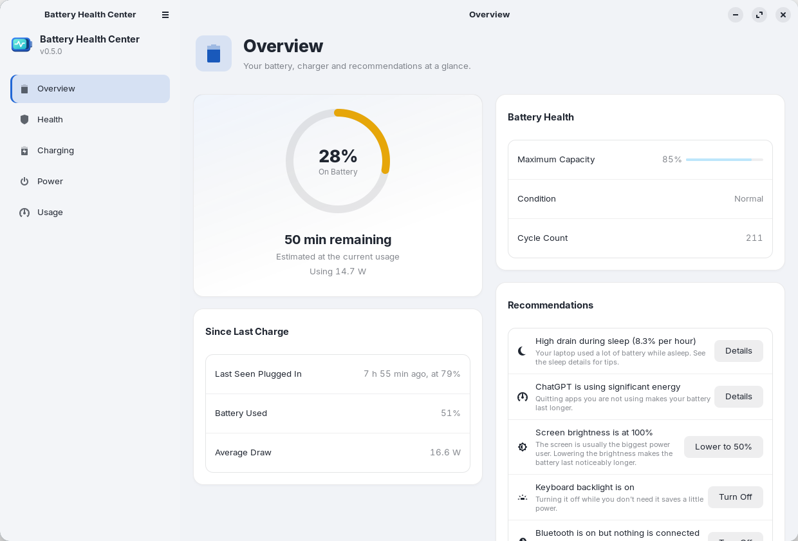

<div align="center">

**English** · [Español](README.es.md) · [Deutsch](README.de.md) · [Français](README.fr.md) · [简体中文](README.zh-CN.md)


# Battery Health Center

**Everything about your laptop battery, in one place.**
Health, cycle count, charge limits and schedules, and which apps drain it, for GNOME.

[](https://github.com/arios4k/battery-health-center/releases/latest)
[](https://github.com/arios4k/battery-health-center/actions/workflows/ci.yml)
[](https://arios4k.github.io/battery-health-center/manual/)
[](https://github.com/arios4k/battery-health-center/releases)
[](#install-ubuntu-debian-and-derivatives)
[](#install-fedora)
[](https://copr.fedorainfracloud.org/coprs/arios/battery-health-center/builds/)
[](LICENSE)
[](#translations)
[](#build-from-source)
[](https://paypal.me/AlexisRios)

<picture>
  <source media="(prefers-color-scheme: dark)" srcset="docs/screenshots/v0.5.0/overview-dark.png">
  
</picture>

</div>

## One app instead of a pile of scripts

Linux gives you the battery numbers, but scattered: a terminal full of `upower` and `/sys` files, a
shell extension for the charge limit, `powertop` for guesses about apps. Battery Health Center puts them
in one native GNOME app, much like the Battery settings on macOS:

| Instead of… | Battery Health Center gives you |
|---|---|
| reading `/sys/class/power_supply` and `upower -i` by hand | **Health**: maximum capacity against design capacity, cycle count, condition, and a trend with a projected 80% date |
| a script or extension to set the charge limit | **Charging**: one-tap profiles, a custom limit, a charging schedule and optimized charging |
| guessing which app drains the battery | **Usage**: apps ranked by energy, with estimated watts and an hour-by-hour view for each |
| digging through Settings, Tweaks and extensions for power options | **Power**: power mode, automatic power mode and GNOME's power-saving settings on one page |
| a spreadsheet of readings | **Reports**: an HTML battery report and CSV exports of your history |

## Manual

**To learn how to use Battery Health Center, read the [Battery Health Center Manual](https://arios4k.github.io/battery-health-center/manual/).** It explains every page step by step: health and calibration, charge limits and the charging schedule, app usage, power modes, notifications, reports and your data, with troubleshooting and a list of what's new in each release. It also opens from the app with **F1** or the help button.

## Why Battery Health Center

- **Native and light.** Rust with GTK 4 and libadwaita: a 1.2 MB program (a 0.5 MB package), light and
  dark mode, and it follows your GNOME theme.
- **Private by design.** Everything stays on your computer: the app never connects to the internet and
  has no telemetry. The history is a few CSV files in your home folder.
- **Careful with root.** Only a small helper runs as root. It accepts nothing but validated values and
  writes only the battery's charge-limit files and its own config.
- **Speaks your language.** English, Spanish, German, French and Simplified Chinese, following your system language.
- **Updates with your system.** Install it from a signed apt repository (or Fedora's COPR) and your usual updates keep it current.

More answers, such as whether the charge limit works on your laptop, are in the manual's [Troubleshooting and FAQ](https://arios4k.github.io/battery-health-center/manual/troubleshooting.html#faq).

<sub>Screenshots taken on Zorin OS 18 with its ZorinBlue theme. Regenerate them with
`docs/screenshots/capture.sh`.</sub>

## Install (Ubuntu, Debian and derivatives)

For Ubuntu 24.04+, Debian 13+, Linux Mint 22,
Zorin OS 18 and other derivatives on 64-bit Intel/AMD:

```bash
sudo install -d -m 0755 /etc/apt/keyrings
curl -fsSL https://arios4k.github.io/apt/key.asc | sudo tee /etc/apt/keyrings/battery-health-center.asc > /dev/null
echo "deb [signed-by=/etc/apt/keyrings/battery-health-center.asc] https://arios4k.github.io/apt stable main" | sudo tee /etc/apt/sources.list.d/battery-health-center.list
sudo apt update && sudo apt install battery-health-center
```

Then open **Battery Health Center** from your applications. Updates arrive with `sudo apt upgrade`. The
signing key's fingerprint is `F090 D01D 74F7 14C8 5A95 23CA 4773 367E BD97 6CF5`, and the repository
(with troubleshooting tips) lives at [arios4k/apt](https://github.com/arios4k/apt).

## Install (Fedora)

For Fedora 43 and newer on 64-bit Intel/AMD, from the [COPR repository](https://copr.fedorainfracloud.org/coprs/arios/battery-health-center/):

```bash
sudo dnf copr enable arios/battery-health-center
sudo dnf install battery-health-center
```

Then open **Battery Health Center** from your applications. Updates arrive with `sudo dnf upgrade`. The
charge-limit and schedule services are turned on by the installation, so nothing else needs setting up.

## Moving from the snap

If you installed an older version as a snap, remove it first with `sudo snap remove battery-health-center`.
That deletes its history, so copy `~/snap/battery-health-center/current/.local/share/battery-health-center/*.csv`
to `~/.local/share/battery-health-center/` before you do.

## Build from source

Requirements: Rust, GTK ≥ 4.14, libadwaita ≥ 1.5, and `gettext` for the translations.

```bash
sudo apt install libgtk-4-dev libadwaita-1-dev pkg-config gettext   # Debian/Ubuntu
cargo run --release
```

Changing the charge limit uses `pkexec` to run `bhc-helper` from the build folder, so it asks for your
password every time until the app is installed. To install it system-wide, run `./install.sh` (remove it
with `./install.sh --uninstall`), or build a package with `scripts/build-locale.sh && cargo deb`.

Handy while developing:

```bash
# try a translation
scripts/build-locale.sh && LANGUAGE=es BHC_LOCALEDIR=$PWD/locale cargo run --release

# try the Charging Schedule screens without touching your real settings: point the app at a folder with
# a stand-in battery-health-center.conf (a line like "BAT0 75 80"), and optionally a
# battery-health-center.schedule and an unplug-log
BHC_HELPER_FILES=/path/to/folder cargo run --release

# save a screenshot of every page
BHC_SCREENSHOTS=/path/to/folder cargo run --release
```

## Translations

The app is available in English, Spanish (`es`), German (`de`), French (`fr`) and Simplified Chinese (`zh_CN`). It uses your system
language and falls back to English for anything that isn't translated. The exported HTML battery report is
still English only. This README and [How it works](docs/HOW-IT-WORKS.md) are also available in
[Español](README.es.md), [Deutsch](README.de.md), [Français](README.fr.md) and [简体中文](README.zh-CN.md); keep them in step when you
change the English text.

To add a language, for example Italian:

```bash
msginit --locale=it --input=po/battery-health-center.pot --output=po/it.po
```

Translate the strings in `po/it.po` (a PO editor such as Poedit or GNOME's Gtranslator helps), then add
`it` to `po/LINGUAS` and a line for it next to the others in `[package.metadata.deb]` in `Cargo.toml`
(the `.mo` assets), and check it with the command above. Pull requests with new languages are very
welcome. `Comment[it]` and `Keywords[it]` in `data/io.github.BatteryHealthCenter.desktop` and a
`<summary xml:lang="it">` in the metainfo file translate how the app is listed.

When the text in the app changes, update the template and the translations (strings that haven't been
translated yet show up as empty and are shown in English):

```bash
python3 scripts/update-pot.py
msgmerge --update --backup=none po/es.po po/battery-health-center.pot   # and the other languages
```

Strings in the code go through `tr("…")`, `trf("… {name}", &[("name", value)])` for text with values
in it, and `trn`/`trnf` for plurals; see `src/i18n.rs`.

## More documentation

- [User manual](https://arios4k.github.io/battery-health-center/manual/): a detailed guide to every feature, with screenshots. Open it from the app with
  the help button or `F1`.
- [How it works](docs/HOW-IT-WORKS.md): where the numbers come from, how the charge limit, the schedule
  and the app energy estimates work.
- [Maintaining and packaging](docs/MAINTAINING.md): publishing a release, and notes for distributions that
  want to include the app. You are welcome to, and I would be honored.
- [The apt repository](https://github.com/arios4k/apt): install steps, troubleshooting and how it is built.

## Contributing

```bash
cargo test
cargo clippy
```

Bug reports, translations and testing on other laptops and distributions are especially welcome: please
[open an issue](https://github.com/arios4k/battery-health-center/issues) with your laptop model and
distribution.

## Support Battery Health Center

If Battery Health Center has been useful to you, please consider [making a donation of any amount](https://paypal.me/AlexisRios) to help keep the project running and support its continued development. Every contribution is appreciated.

The intention is to keep Battery Health Center free and available to everyone. Thank you for using it and for any support you can offer!

## Author

Created by **Alexis Rios-Negron**.

## License

GPL-3.0-or-later © Alexis Rios-Negron. See [LICENSE](LICENSE).
