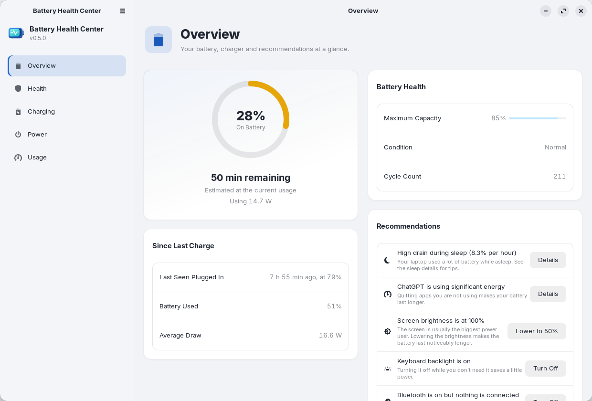
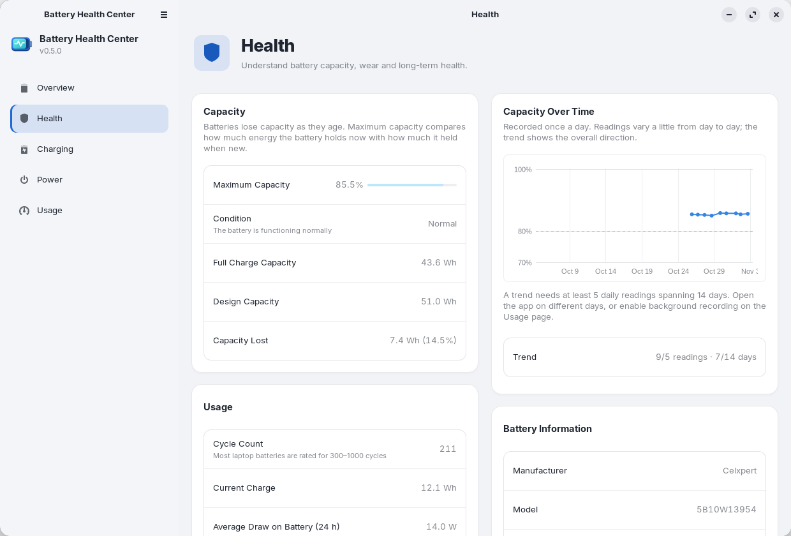
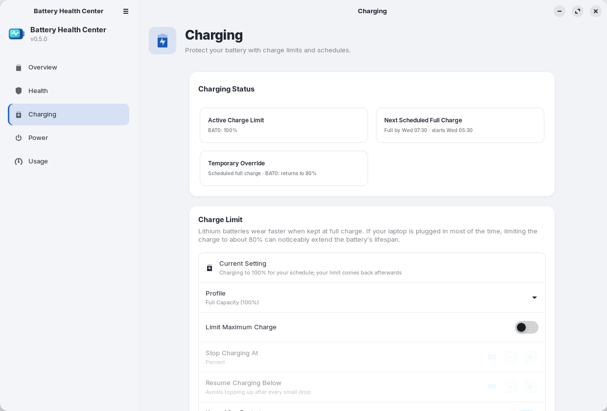
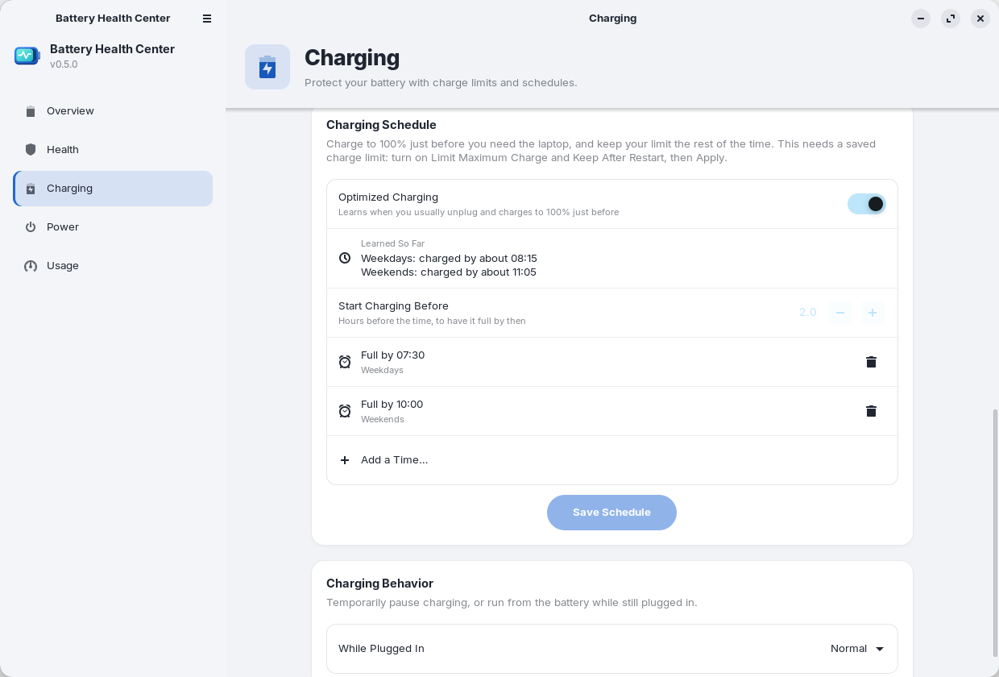
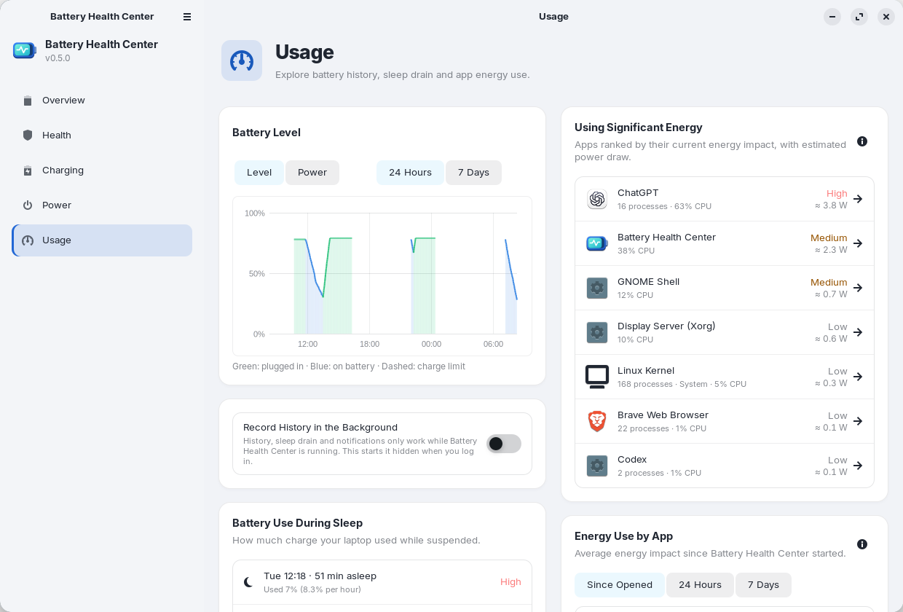
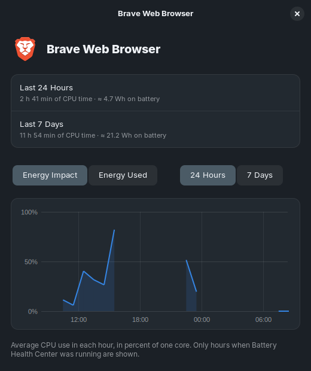
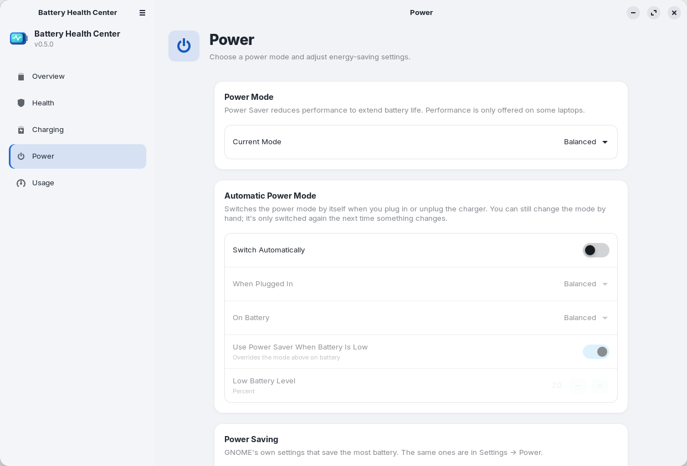

<div align="center">

[English](README.md) · [Español](README.es.md) · [Deutsch](README.de.md) · [Français](README.fr.md) · **简体中文**


# Battery Health Center

**笔记本电脑电池的一切，尽在一处。**
电池健康、循环次数、充电上限与计划，以及哪些应用在耗电，专为 GNOME 打造。

[](https://github.com/arios4k/battery-health-center/releases/latest)
[](https://github.com/arios4k/battery-health-center/actions/workflows/ci.yml)
[](#在-ubuntu-和-debian-上安装)
[](#在-fedora-上安装)
[](LICENSE)
[](#翻译)
[](#从源码构建)

<picture>
  <source media="(prefers-color-scheme: dark)" srcset="docs/screenshots/v0.5.0/overview-dark.png">
  
</picture>

</div>

## 一个应用，取代一堆脚本

Linux 能提供电池数据，但它们分散各处：满屏 `upower` 和 `/sys` 文件的终端、用来设置充电上限的 Shell 扩展、
靠 `powertop` 猜测哪些应用耗电。Battery Health Center 把它们汇集到一个原生 GNOME 应用中，有点像 macOS
的电池设置：

| 原本需要… | Battery Health Center 提供 |
|---|---|
| 手动读取 `/sys/class/power_supply` 和 `upower -i` | **健康**：最大容量与设计容量对比、循环次数、状态，以及预计降至 80% 的日期趋势 |
| 用脚本或扩展设置充电上限 | **充电**：一键切换配置、自定义上限、充电计划和优化充电 |
| 猜测哪个应用在耗电 | **使用情况**：按能耗排序的应用，附估算功率和逐小时视图 |
| 在“设置”、“优化”和各种扩展中寻找电源选项 | **电源**：电源模式、自动电源模式和 GNOME 的节能设置集中在一个页面 |
| 一张记录读数的电子表格 | **报告**：HTML 电池报告和历史数据的 CSV 导出 |

## 功能

### 🔋 真正了解电池的健康状况

最大容量与新品时的对比、电池状态（正常、已损耗或建议维修）、循环次数、电压、制造商、型号和化学类型。容量每天
记录一次，大约两周后即可看到趋势以及预计降至 80% 的日期。如果电量百分比跳变，或笔记本电脑过早关机，引导式
校准（充电、几乎放电至耗尽、再次充电）可以修正读数。支持配有两块电池的笔记本电脑。

<picture>
  <source media="(prefers-color-scheme: dark)" srcset="docs/screenshots/v0.5.0/health-dark.png">
  
</picture>

### 🛡️ 让电池用上好几年

锂电池长期保持 100% 电量会损耗得更快。选择一个配置：**最长寿命（60%）**、**平衡（80%）**或**完整容量（100%）**，
也可以精确设定停止和恢复充电的电量。上限在重启和睡眠后依然保留。出行需要满电？点击**立即充电至 100%**，只
充满一次，之后您的上限会自动恢复。

<picture>
  <source media="(prefers-color-scheme: dark)" srcset="docs/screenshots/v0.5.0/charging-dark.png">
  
</picture>

### 🗓️ 需要时充满，其余时间受保护

告诉它您什么时候要用笔记本电脑，例如**工作日 07:30**，上限会在此之前不久解除，让电池按时充满，然后再恢复。
或者开启**优化充电**，它会根据您通常拔下电源的时间学习您的习惯。您只需在保存计划时输入一次密码，其余由一个
小型服务完成。

<picture>
  <source media="(prefers-color-scheme: dark)" srcset="docs/screenshots/v0.5.0/schedule-dark.png">
  
</picture>

### 📊 看清是什么在耗电

查看过去一天或一周的电量和功耗、笔记本电脑睡眠期间的电池消耗（异常偏高时会发出警告），以及此刻、自打开
应用以来、过去 24 小时和 7 天内最耗电的应用。点击某个应用，可查看其能耗影响和逐小时的估算使用情况。
Linux 不会按应用测量功率，所以这些数字是根据 CPU 时间和高于空闲状态的实测功耗得出的估算值。

<picture>
  <source media="(prefers-color-scheme: dark)" srcset="docs/screenshots/v0.5.0/usage-dark.png">
  
</picture>

<div align="center">

</div>

### ⚡ 无需费力寻找的电源模式

节能、平衡或性能模式，外加**自动电源模式**，在您接通或拔下充电器时自动切换；还包括 GNOME 的节能设置（调暗
屏幕、关闭屏幕、自动挂起、电源按钮和屏幕盖），以及顶栏中的电量百分比。只显示您的硬件支持的选项。

<picture>
  <source media="(prefers-color-scheme: dark)" srcset="docs/screenshots/v0.5.0/power-dark.png">
  
</picture>

### 💡 小提醒，不打扰

使用电池时，“概览”可能会建议您调低过亮的屏幕、关闭键盘背光，或在没有连接设备时关闭蓝牙，每条建议都带有
一个按钮。通知会在以下情况提醒您：达到充电上限、没有上限时已充满、电量不足、某个应用在耗电，以及笔记本电脑
在睡眠期间消耗了大量电量。您可以在“首选项”中关闭这些通知（校准步骤除外）。

### 📤 带走您的数据

通过菜单导出 HTML 电池报告（用于保修申请，或出售笔记本电脑时），也可以运行
`battery-health-center --export-report report.html`。**将数据导出为 CSV**（或
`battery-health-center --export-csv <文件夹>`）会把电池历史、容量变化、睡眠记录和各应用每小时的能耗
写成 CSV 文件，方便用电子表格处理。

## 为什么选择 Battery Health Center

- **原生且轻量。** 使用 Rust、GTK 4 和 libadwaita：程序仅 1.2 MB（软件包 0.5 MB），支持浅色和深色模式，并跟随
  您的 GNOME 主题。
- **默认注重隐私。** 一切都留在您的电脑上：应用从不联网，也没有遥测。历史记录只是您主目录中的几个 CSV 文件。
- **谨慎使用 root。** 只有一个小型辅助程序以 root 身份运行。它只接受经过验证的值，并且只写入电池的充电上限
  文件和它自己的配置。
- **说您的语言。** 英语、西班牙语、德语、法语和简体中文，跟随您的系统语言。
- **随系统更新。** 从已签名的 apt 仓库（或 Fedora 的 COPR）安装，日常系统更新就会让它保持最新。

## 常见问题

**充电上限能在我的笔记本电脑上使用吗？**
只要笔记本电脑使用标准的 Linux 电池驱动，就能查看电池信息。充电上限需要固件支持，并由内核以
`charge_control_end_threshold`（或 `charge_stop_threshold`）的形式提供，例如 ThinkPad 以及许多华硕（ASUS）、
戴尔（Dell）、华为、LG、三星和 System76 笔记本电脑。如果您的设备不支持，“充电”页面会说明，其余功能仍可正常使用。

**支持哪些桌面环境和发行版？**
开发和测试都在 GNOME 上进行：Ubuntu 24.04、Zorin OS 18 和 Linux Mint 22。软件包需要 GTK 4.14 和 libadwaita 1.5
或更高版本，因此 Ubuntu 22.04、Debian 12 和 Mint 21 版本过旧。“电源”页面使用 GNOME 自身的设置，因此它是与
GNOME 绑定最紧的部分。

**更改充电上限安全吗？**
它设置的是其他工具和 BIOS 选项所使用的同一组固件阈值，选择**完整容量（100%）**即可再次取消上限。更改时需要
输入您的密码。

**我需要一直打开这个应用吗？**
历史、睡眠耗电和通知只在应用运行时记录。首次打开时，它会询问是否**在后台记录历史**；选择“是”，它就会在您
登录时隐藏启动。您可以随时在“使用情况”页面更改这一选择。

<sub>截图在 Zorin OS 18 上使用其 ZorinBlue 主题拍摄。可用 `docs/screenshots/capture.sh` 重新生成。</sub>

## 在 Ubuntu 和 Debian 上安装

适用于 Ubuntu 24.04+、Debian 13+、Linux Mint 22、Zorin OS 18 及其他衍生版，仅限 64 位 Intel/AMD：

```bash
sudo install -d -m 0755 /etc/apt/keyrings
curl -fsSL https://arios4k.github.io/apt/key.asc | sudo tee /etc/apt/keyrings/battery-health-center.asc > /dev/null
echo "deb [signed-by=/etc/apt/keyrings/battery-health-center.asc] https://arios4k.github.io/apt stable main" | sudo tee /etc/apt/sources.list.d/battery-health-center.list
sudo apt update && sudo apt install battery-health-center
```

然后在应用程序列表中打开 **Battery Health Center**。更新通过 `sudo apt upgrade` 获取。签名密钥的指纹是
`F090 D01D 74F7 14C8 5A95 23CA 4773 367E BD97 6CF5`，仓库（含故障排除提示）位于
[arios4k/apt](https://github.com/arios4k/apt)。

## 在 Fedora 上安装

适用于 Fedora 43 及更新版本，仅限 64 位 Intel/AMD，来自 [COPR 仓库](https://copr.fedorainfracloud.org/coprs/arios/battery-health-center/)：

```bash
sudo dnf copr enable arios/battery-health-center
sudo dnf install battery-health-center
```

然后在应用程序列表中打开 **Battery Health Center**。更新通过 `sudo dnf upgrade` 获取。充电上限和计划服务会在
安装时自动启用，无需其他设置。

## 从 snap 迁移

如果您安装过旧版本的 snap，请先用 `sudo snap remove battery-health-center` 将其移除。这会删除其历史记录，所以
请在此之前把 `~/snap/battery-health-center/current/.local/share/battery-health-center/*.csv` 复制到
`~/.local/share/battery-health-center/`。

## 从源码构建

依赖：Rust、GTK ≥ 4.14、libadwaita ≥ 1.5，以及用于翻译的 `gettext`。

```bash
sudo apt install libgtk-4-dev libadwaita-1-dev pkg-config gettext   # Debian/Ubuntu
cargo run --release
```

更改充电上限会使用 `pkexec` 从构建目录运行 `bhc-helper`，因此在应用安装之前，每次都会要求输入密码。如需系统级
安装，请运行 `./install.sh`（用 `./install.sh --uninstall` 卸载），或用 `scripts/build-locale.sh && cargo deb`
构建软件包。

开发时的实用命令：

```bash
# 试用某个翻译
scripts/build-locale.sh && LANGUAGE=zh_CN BHC_LOCALEDIR=$PWD/locale cargo run --release

# 试用充电计划界面而不影响您的真实设置：让应用指向一个包含模拟 battery-health-center.conf 的文件夹
# （例如一行 "BAT0 75 80"），还可以选择性地加入 battery-health-center.schedule 和 unplug-log
BHC_HELPER_FILES=/path/to/folder cargo run --release

# 为每个页面保存一张截图
BHC_SCREENSHOTS=/path/to/folder cargo run --release
```

## 翻译

应用提供英语、西班牙语（`es`）、德语（`de`）、法语（`fr`）和简体中文（`zh_CN`）版本。它会使用您的系统语言，
未翻译的内容则回退为英语。导出的 HTML 电池报告目前仍然只有英文。本 README 和[工作原理](docs/HOW-IT-WORKS.zh-CN.md)
也提供
[English](README.md)、[Español](README.es.md)、[Deutsch](README.de.md) 和 [Français](README.fr.md) 版本。

要添加一种语言，例如意大利语：

```bash
msginit --locale=it --input=po/battery-health-center.pot --output=po/it.po
```

翻译 `po/it.po` 中的字符串（Poedit 或 GNOME 的 Gtranslator 等 PO 编辑器会有帮助），然后把 `it` 添加到
`po/LINGUAS`，并在 `Cargo.toml` 的 `[package.metadata.deb]` 中仿照其他语言添加一行（`.mo` 文件），再用上面的
命令检查。非常欢迎提交新增语言的 Pull Request。`data/io.github.BatteryHealthCenter.desktop` 中的
`Comment[it]` 和 `Keywords[it]`，以及 metainfo 文件中的 `<summary xml:lang="it">`，用于翻译应用在软件列表中的
显示。

当应用中的文字发生变化时，请更新模板和翻译（尚未翻译的字符串会显示为空，并以英语显示）：

```bash
python3 scripts/update-pot.py
msgmerge --update --backup=none po/zh_CN.po po/battery-health-center.pot   # 以及其他语言
```

代码中的字符串通过 `tr("…")` 处理；带参数的文本用 `trf("… {name}", &[("name", value)])`；复数用
`trn`/`trnf`，详见 `src/i18n.rs`。

## 更多文档

- [工作原理](docs/HOW-IT-WORKS.zh-CN.md)：数据从何而来，以及充电上限、充电计划和应用能耗估算是如何工作的。
- [维护与打包](docs/MAINTAINING.md)（英文）：如何发布新版本，以及给希望收录本应用的发行版的说明。欢迎收录，
  我将深感荣幸。
- [apt 仓库](https://github.com/arios4k/apt)：安装步骤、故障排除以及构建方式。

## 参与贡献

```bash
cargo test
cargo clippy
```

特别欢迎错误报告、翻译，以及在其他笔记本电脑和发行版上的测试：请[提交 issue](https://github.com/arios4k/battery-health-center/issues)，
并附上您的笔记本电脑型号和发行版。

## 作者

由 **Alexis Rios-Negron** 创建。

## 许可证

GPL-3.0-or-later © Alexis Rios-Negron。详见 [LICENSE](LICENSE)。
